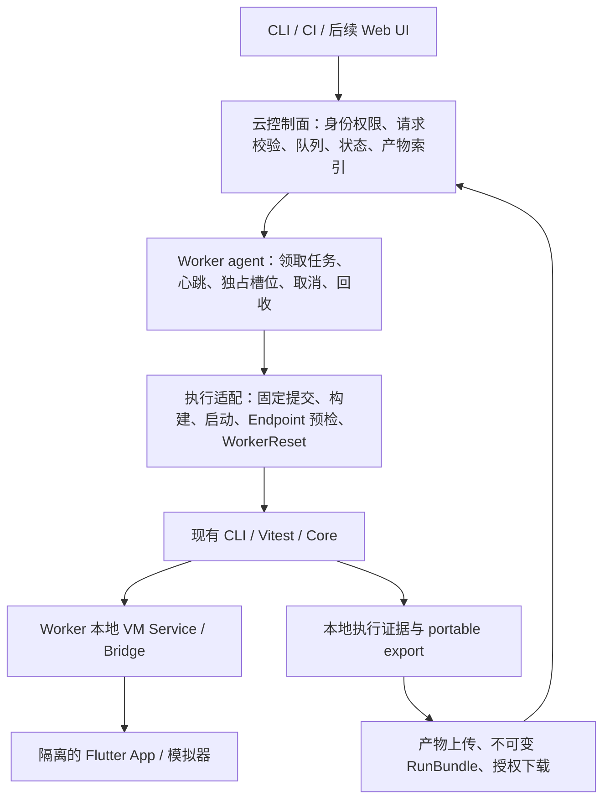

# Fliwright 云测平台可行性评估

日期：2026-10-18。评估对象：当前工作区源码，包括尚未提交的变更。

本文是源码与仓库一手资料的静态评估。本次没有启动设备、执行云端任务、进行容量压测，亦未重新核验历史验收产物。
“已实现”指能在当前源码定位到的行为；“已有验收记录”指仓库兼容性文档的声明；“推断”与“建议”不构成已交付能力。

## 结论与适用范围

**可以将 Fliwright 打造为云测平台，最合适的定位是：面向可接入 Bridge 的 Flutter 应用，提供团队托管的业务回归与测试证据服务。当前已具备执行引擎基础，还需要建设云端控制面和 Worker 运维闭环。**

| 产品方向 | 判断 | 前提与边界 |
| --- | --- | --- |
| 团队内部、单租户 Flutter 云回归 | Go | 团队控制源码、测试入口、Worker 与模拟器；先跑确定性脚本 |
| 自建 Android/iOS 模拟器测试服务 | 有条件 Go | 按平台补齐构建、启动、重置、排队、故障恢复与验收 |
| 对外商业多租户 SaaS | 有条件 Go，另立平台工程范围 | 需要不可信代码隔离、身份权限、配额、计量、审计与数据隔离 |
| 上传任意 Release APK/IPA 的通用黑盒云测 | 当前架构不适配 | 当前 Bridge 依赖应用接入与 VM Service，Release 初始化被拒绝 |
| 全面覆盖原生 App、跨 App 与系统 UI 的设备农场 | 当前能力不足 | Flutter 进程内驱动不能等同于完整设备级自动化 |

定位依据：Bridge 通过 `ext.fliwright.*` 注册进程内控制能力，Core 通过 WebSocket 连接 VM Service；Release 下初始化直接返回。
见 [bridge.dart:75](../../packages/fliwright-bridge/lib/src/bridge.dart#L75)、[bridge.dart:246](../../packages/fliwright-bridge/lib/src/bridge.dart#L246)、[VMServiceConnector.ts:34](../../packages/fliwright-core/src/VMServiceConnector.ts#L34)。

仓库已明确首期采用单租户 `TeamTestQueue`、团队 Mac mini Worker、预注册 `ApplicationTarget`：
[ADR 0002:3](../adr/0002-start-cloud-platform-with-a-single-tenant-team-queue.md#L3)、[ADR 0003:3](../adr/0003-run-queued-e2e-work-on-team-operated-workers.md#L3)、[ADR 0004:3](../adr/0004-restrict-queued-work-to-registered-application-targets.md#L3)。
这些是产品决策，不能作为平台已经实现的证据。

## 可以复用的执行基础

| 能力 | 当前事实 | 对云测的价值与剩余边界 |
| --- | --- | --- |
| 程序化启动与执行 | CLI `run/script` 接受 `deviceId`，通过 daemon 启动 App、取得 `wsUri`，结束后停止和释放 | 可作为 Worker 执行入口；尚需围绕进程崩溃、主机重启与设备残留做外层托管 |
| 结构化结果 | CLI 支持 JSON、JUnit、超时、取消、独立产物目录及 runner errors | 可接入 CI/API；业务失败与基础设施失败仍需形成平台分类策略 |
| Endpoint 抽象 | Core 已有 direct-vm/dds/relay、execution-worker scope、严格握手与所需能力检查 | 可扩展远程设备供应商；`relay` 类型本身不代表已有供应商集成 |
| 确定性环境 | 命名、组合式 `TestScenario` 包含 mocks/storage/auth/state/app/navigation 和 ready checks | 可将业务准备条件版本化；不能代替模拟器、操作系统和后端数据重置 |
| 互斥执行 | EndpointLease 使用本机文件锁、PID 与心跳串行化同一 endpoint 的测试 | 可保留为 Worker 内保护；不能充当跨主机设备租约 |
| 证据与导出 | 本地 run manifest、attempt result、events、Timeline/Trace，以及 portable export | 可复用作为上传来源；对象存储、查询索引、权限和保留期仍需实现 |
| 故障证据恢复 | 进度日志支持恢复运行结果和证据 | 恢复证据不等于从中断 UI 状态继续执行测试 |
| 持久 CLI session | 本地 socket、operation 去重、取消与状态持久化 | 是本地连接管理基础，不是带身份认证的云 API 或远程调度器 |

对应源码：

- 启动和释放：[finite.ts:41](../../packages/fliwright-cli/src/registry/finite.ts#L41)；报告与进程生命周期：[run.ts:25](../../packages/fliwright-cli/src/commands/run.ts#L25)、[run.ts:221](../../packages/fliwright-cli/src/commands/run.ts#L221)。
- Endpoint 模型与预检：[VmServiceEndpoint.ts:13](../../packages/fliwright-core/src/VmServiceEndpoint.ts#L13)、[VmServiceEndpoint.ts:117](../../packages/fliwright-core/src/VmServiceEndpoint.ts#L117)、[VmServiceEndpoint.ts:164](../../packages/fliwright-core/src/VmServiceEndpoint.ts#L164)；daemon provider：[FlutterDaemonEndpointSource.ts:22](../../packages/fliwright-tdd/src/daemon/FlutterDaemonEndpointSource.ts#L22)。
- 场景及隔离准备：[Scenario.ts:7](../../packages/fliwright-core/src/Scenario.ts#L7)、[Scenario.ts:175](../../packages/fliwright-core/src/Scenario.ts#L175)；场景指纹：[Scenario.ts:103](../../packages/fliwright-core/src/Scenario.ts#L103)。
- 互斥与本机目录：[EndpointLease.ts:30](../../packages/fliwright-core/src/EndpointLease.ts#L30)、[EndpointLease.ts:129](../../packages/fliwright-core/src/EndpointLease.ts#L129)。
- 本地产物：[RunArtifactStore.ts:18](../../packages/fliwright-core/src/RunArtifactStore.ts#L18)；portable export 与完整性检查：[artifacts.ts:38](../../packages/fliwright-cli/src/commands/artifacts.ts#L38)；符号链接与路径边界检查：[artifacts.ts:264](../../packages/fliwright-cli/src/commands/artifacts.ts#L264)。
- 恢复：[RunProgressJournal.ts:108](../../packages/fliwright-core/src/RunProgressJournal.ts#L108)；本地 session：[worker.ts:34](../../packages/fliwright-cli/src/session/worker.ts#L34)、[worker.ts:97](../../packages/fliwright-cli/src/session/worker.ts#L97)。

推断：Fliwright 的主要复用价值是 Flutter 业务语义、状态准备、脚本执行与故障证据；建设云平台时，设备供给和分布式任务生命周期仍是独立工程。

## 平台与测试覆盖边界

### Build mode

- **Debug：建议作为首版默认。** 当前 generated smoke 使用 `flutter run --debug`，见 [run-generated-smoke.mjs:59](../../e2e/scripts/run-generated-smoke.mjs#L59)。
- **Profile：代码未统一禁止，但不能承诺完整能力。** Bridge 仅拒绝 Release，并在握手返回 debug/profile/release 标志；部分观察与录制使用 Flutter debug 信息，需按目标 SDK、平台和能力实证。见 [bridge.dart:201](../../packages/fliwright-bridge/lib/src/bridge.dart#L201)、[inspect.dart:1389](../../packages/fliwright-bridge/lib/src/extensions/inspect.dart#L1389)、[recording.dart:257](../../packages/fliwright-bridge/lib/src/extensions/recording.dart#L257)。
- **Release：当前不支持。** Bridge 不注册扩展；daemon endpoint source 也拒绝显式 `--release`。见 [bridge.dart:246](../../packages/fliwright-bridge/lib/src/bridge.dart#L246)、[FlutterDaemonEndpointSource.ts:31](../../packages/fliwright-tdd/src/daemon/FlutterDaemonEndpointSource.ts#L31)。

推断：Debug 业务回归结果不能直接充当 Release 性能、启动时长或资源消耗的基准。性能测试应有独立 build mode、测量协议与设备验收。

### 各平台的证据强度

| 平台 | 仓库已有证据 | 云平台首版建议 |
| --- | --- | --- |
| macOS desktop | generated E2E smoke；受控录制与回放；native capture 仍有独立待验项 | 作为 Worker 自检与引擎回归基线 |
| Android emulator | API 35 ARM64 模拟器的原生输入/表单、拖动、故障与 lease 受控切片 | 可做首批移动端目标，补独立 Worker 运行验收 |
| iOS simulator | iOS 26.5 ARM64 模拟器的输入/表单、部分 IME/手势、故障与 lease 切片 | Mac Worker 承载，按 Xcode/SDK/机型配置验收 |
| Android/iOS 真机 | 兼容性文档保留为独立验收门槛 | 后续接入，不能继承模拟器验收结论 |
| Linux desktop | Dart/TypeScript CI；smoke 脚本有 Linux 路径 | 不能将“脚本能选择 Linux”写成已通过桌面 release gate |
| Windows desktop | 未 release-gated | 单独补 smoke 与环境运维 |
| Flutter Web | 未 release-gated | 单独验证编译、调试传输和 Bridge 能力，不纳入首版承诺 |

证据来源：[compatibility.md:67](../release/compatibility.md#L67)。当前持续集成的 generated E2E job 实际使用 `macos-latest`，见 [ci.yml:99](../../.github/workflows/ci.yml#L99)；smoke 脚本的平台选择见 [run-generated-smoke.mjs:7](../../e2e/scripts/run-generated-smoke.mjs#L7)。
已有 Android/iOS 的本地受控验证，不等于已有 Android/iOS 云端设备池、规模验证或平台 SLA。

### Flutter、WebView、原生与系统 UI

**已实现：** Widget/语义观察、Flutter 内输入与手势、Flutter 渲染画面截图，以及应用主动注册的测试能力。
Bridge 将扩展注册到 Dart 进程，手势通过 `GestureBinding` 分发，截图来自 Flutter RenderView。
见 [extension_registry.dart:37](../../packages/fliwright-bridge/lib/src/extension_registry.dart#L37)、[gesture.dart:527](../../packages/fliwright-bridge/lib/src/extensions/gesture.dart#L527)、[screenshot.dart:47](../../packages/fliwright-bridge/lib/src/extensions/screenshot.dart#L47)。

**需要限制承诺：** 源码的 `dragFrom` 注释提到 WebView overlay，但实际仍注入 Flutter pointer event。
这不能证明通用 WebView DOM 定位、原生平台视图完整输入、系统权限弹窗、通知栏、跨 App 跳转或整机截图已被覆盖。
见 [gesture.dart:468](../../packages/fliwright-bridge/lib/src/extensions/gesture.dart#L468)。

**建议：** 将设备级操作放入明确的 Worker adapter；确需系统 UI/原生/WebView 时，评估平台原生自动化或浏览器驱动的辅助接入，分别验收。
首版业务回归通过应用自有 `auth.seedLoggedIn` 注入测试会话，避免真实登录与验证码依赖，见 [Scenario.ts:265](../../packages/fliwright-core/src/Scenario.ts#L265)。
现有 `flow.manual` 默认通过本地文件等待继续或取消；云端人工接管、画面传输与权限控制需另建，见 [FlowRuntime.ts:394](../../packages/fliwright-core/src/timeline/FlowRuntime.ts#L394)。

## 建议的平台分层

这是一份建议架构，不是现有部署拓扑。控制面调度任务，测试与 VM Service 连接在同一 Worker 内完成。
优先采用 Worker 主动拉取任务；由平台维护稳定的 `workerId/deviceId/slotId`，endpoint URL 只作为本次执行的临时连接能力。

当前模块边界要求 Core 拥有通用运行语义、CLI 拥有命令入口、Bridge 拥有应用内能力；云控制面应独立规划，避免塞入 Bridge 或 Core。
若新增包、依赖或跨包调用，需遵循现有架构与框架审批契约，见 [architecture/README.md:13](../../harness/architecture/README.md#L13)、[architecture/README.md:79](../../harness/architecture/README.md#L79)。

## 建平台必须补齐的能力

| 优先级 | 缺口 | 最小交付边界 |
| --- | --- | --- |
| P0 | 持久队列与请求 API | 提交/查询/取消、幂等键、明确状态机、FIFO、任务归属与失败原因 |
| P0 | Worker 与槽位托管 | 注册、能力上报、心跳、持久 claim、租约代次、失联回收、禁止过期 Worker 回写 |
| P0 | 构建与目标复现 | 只接受注册 target + 不可变 commit SHA；锁定 SDK、入口、模拟器镜像、脚本与场景版本 |
| P0 | WorkerReset 与隔离 | 前后重置进程、应用数据、mock、临时文件、所需后端状态；失败后 quarantine |
| P0 | Endpoint 托管 | 复用严格 verifier；校验目标模式/能力、设置外层连接超时；重启后废弃旧连接 |
| P0 | 产物与状态收敛 | 保留每次 attempt 的原始结论和 partial 证据；上传校验、重试、最终状态对账 |
| P0 | 单团队权限和秘密管理 | 用户/Worker 身份、target allowlist、凭据预置、授权下载、审计、保留期 |
| P1 | 多槽位与设备矩阵 | 基于真实 device/slot 身份分配资源，构建缓存与资源限额，逐平台验收 |
| P1 | 产品体验 | 浏览器报告、失败聚合、flaky 历史、提交关联与 CI 门禁 |
| P2 | 多租户商业化 | 不可信构建/测试隔离、网络策略、跨租户存储边界、配额、计量和运营 |
| P2 | 自然语言与 Issue 规划 | 在执行闭环稳定后接入 Planner，保留 NeedsInput、人工确认与确定性回归脚本 |

缺口判定依据：当前 `packages` 的 TypeScript/Dart 源码未检索到 `TeamTestQueue/ExecutionWorker/WorkerReset/ApplicationTarget/ExecutionSlot/RunBundle` 对应平台实现；这些术语出现在领域与 ADR 文档。
本地 session 的队列/状态和 endpoint 文件锁有不同职责，不能据此认定云调度已存在。

当前 run manifest 只有 runId/status/evidenceStatus/runnerErrors/tests，缺少平台 job、worker、设备、应用提交与构建身份。
建议在平台 RunBundle 外层关联这些信息，保留现有引擎产物契约，见 [RunContracts.ts:118](../../packages/fliwright-core/src/RunContracts.ts#L118)。

当前严格 endpoint verifier 已检查握手就绪和能力，但 `Driver.connect()` 的握手仍是 best-effort；平台不能只连接成功就开始测试。
见 [Driver.ts:115](../../packages/fliwright-core/src/Driver.ts#L115)、[VmServiceEndpoint.ts:118](../../packages/fliwright-core/src/VmServiceEndpoint.ts#L118)。

## 安全与隔离的实际边界

仓库安全模型明确：VM Service 属于可信测试基础设施，不能将其直接发布为生产控制面。
平台应暴露经过身份校验的任务 API；VM Service 保持 Worker 内可达，完整 URL/token 不进入 UI、公共日志或共享缓存。
见 [security.md:7](../release/security.md#L7)、[security.md:19](../release/security.md#L19)。

应用测试能力能执行 App 注册的任意 handler；Bridge registry 直接转发请求，没有团队/租户身份判定。
这适用于受信环境，无法独立承担 SaaS 隔离，见 [app_instance.dart:155](../../packages/fliwright-bridge/lib/src/extensions/app_instance.dart#L155)、[extension_registry.dart:39](../../packages/fliwright-bridge/lib/src/extension_registry.dart#L39)。

允许执行项目 TypeScript 脚本以及项目构建，本身就涉及代码执行。预注册 target 降低输入面，但不能把不可信仓库、依赖安装与构建脚本变成安全代码。
首版建议限制为团队授权仓库与固定执行配置；对外开放前使用适合平台的独立主机/VM 等隔离边界，并限制网络、文件和凭据访问。

已有报告字符串脱敏与产物路径检查，不代表全链路防泄漏。截图、Widget 树、网络响应与异常仍可能包含敏感信息，需按来源落实数据策略。
见 [RunSession.ts:220](../../packages/fliwright-core/src/RunSession.ts#L220)、[security.md:28](../release/security.md#L28)。

应用内 storage reset 依赖 App 注册 handler；未注册会返回 unsupported，不能声称已清空设备状态。
HTTP mock 也不是整机网络隔离：HttpOverrides 只处理 plain HTTP，Dio HTTPS 需主动接入 interceptor，系统插件/原生/WebView 流量应单独验证。
见 [storage_reset.dart:24](../../packages/fliwright-bridge/lib/src/extensions/storage_reset.dart#L24)、[http_overrides.dart:6](../../packages/fliwright-bridge/lib/src/extensions/http_overrides.dart#L6)、[bridge.dart:120](../../packages/fliwright-bridge/lib/src/bridge.dart#L120)。

## 推荐 MVP 与推进顺序

**MVP 范围：单团队、专用 Mac mini、一个 ExecutionSlot、FIFO、注册的 Flutter target、Debug 模拟器、仓库内确定性脚本、API/CLI 提交与取结果。**
一个物理 Worker 不等于只能运行一个模拟器；首期单槽位是控制隔离和验证成本的产品选择，后续以容量实测决定扩展。
该范围对齐 [CONTEXT.md:96](../../CONTEXT.md#L96)、[CONTEXT.md:116](../../CONTEXT.md#L116)、[CONTEXT.md:141](../../CONTEXT.md#L141)。

1. **先证明单次远程闭环。** 固定 target/commit/script/scenario，执行 checkout → build → WorkerReset → 启动 → 严格预检 → run → 导出/上传 → reset，能通过 API 读取结果。
2. **再证明托管可靠性。** 加入 FIFO、幂等、取消、心跳、失联回收、attempt fencing、状态与上传对账；重启控制面也不会重复派发有效执行。
3. **随后做平台覆盖与体验。** Android emulator 与 iOS simulator 分别验收；Web UI、失败趋势与 CI gate 使用同一 API。
4. **最后扩展复杂度。** 多槽位、真机、供应商 adapter、多租户与 AI 规划分别立项，避免在执行闭环尚未稳定时一并承诺。

已有确定性脚本仍需被规范化为受校验的 TestPlan/执行描述，不必为首版同时建设自然语言 Planner。
基础设施瞬态故障最多自动增加一次 ExecutionAttempt，断言或业务失败直接终结；每次 attempt 分开保留证据，遵循 [CONTEXT.md:121](../../CONTEXT.md#L121)。
RunBundle 的默认保留期可采用已有 30 天产品决策，但对象存储生命周期和授权下载需真实实现，见 [ADR 0007:3](../adr/0007-retain-immutable-run-bundles-for-thirty-days.md#L3)。

## 进入团队试用的验收门槛

以下均是建议新增的云平台门槛，不是本次已执行的测试：

- **执行正确性：** 同一提交/场景可以重复执行；注入真实业务反例必须失败；自动 healing 或重试不得隐藏原始断言失败。
- **排队与互斥：** 并发提交在单槽位串行执行；重复提交幂等；旧 Worker/旧代次不能执行已回收任务或覆盖新 attempt。
- **取消与故障：** 排队取消不启动 App；运行取消有期限；杀 Worker、重启服务、丢 VM 连接后状态收敛，无孤儿进程与悬挂槽位。
- **隔离复位：** 前一任务写入登录/存储/mock/路由状态，下一任务不能继承；reset 失败自动摘除 Worker。
- **证据完整性：** 每次 attempt 保留 verdict 与 complete/partial 标记；上传失败可对账；删除 Worker 本地源目录后云端仍可读取结果、Trace 与截图。
- **权限与脱敏：** 未授权用户/Worker不能提交或读取；VM URL/token 与预置凭据不进入日志/产物；构建和脚本没有超出批准范围的主机访问。
- **平台独立性：** Android 与 iOS 各自跑完整闭环、正反例和故障矩阵；真机/Web/Windows 未验收前保持不承诺。
- **运维与容量：** 持续记录 queue wait、构建缓存命中率、构建/启动/执行/reset/上传耗时、失联、基础设施失败和证据缺失；由实测确定试用规模与超时。

容量预算应从真实槽位和完整生命周期计算：

`单槽位占用时间 = checkout + build + reset_before + launch/preflight + test + export/upload + reset_after`

`吞吐上界 ≈ 可用独立槽位数 / 平均槽位占用时间`

该公式需按秒或分钟统一单位，并计入重试、隔离后的不可用时间和构建争用；异步上传只有在真实释放槽位后才可移出占用时间。
先测冷构建、缓存构建、短用例与真实业务套件的 P50/P95，再承诺吞吐、排队时延或 SLA；本次不提供未经测量的成本和工期数字。

## 决策建议

建议批准“团队内部 Flutter 云回归 MVP”的方向，并把首个里程碑定义为：**远程提交一个固定提交的测试，在专用模拟器上独占执行，取得可离线复核的产物，完成重置并安全处理取消和 Worker 失联。**

这个里程碑通过后再扩大设备矩阵与用户规模。商业多租户、任意 Release 包与全面系统 UI 自动化应有各自的架构和验收边界。
