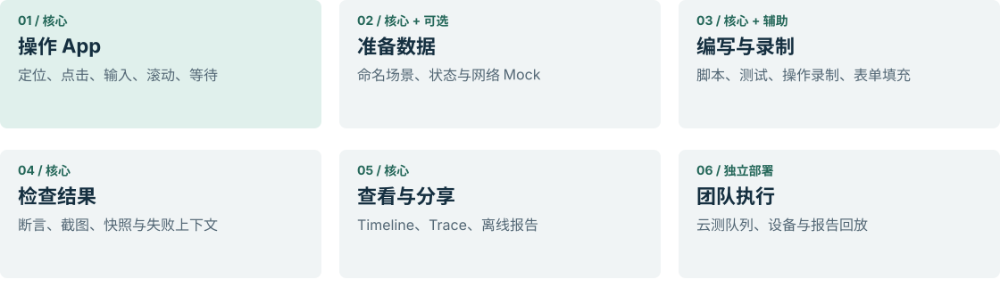
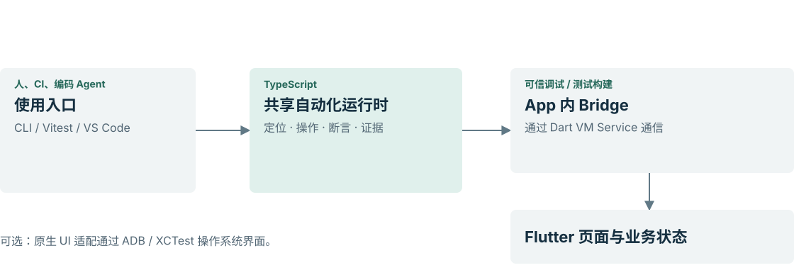
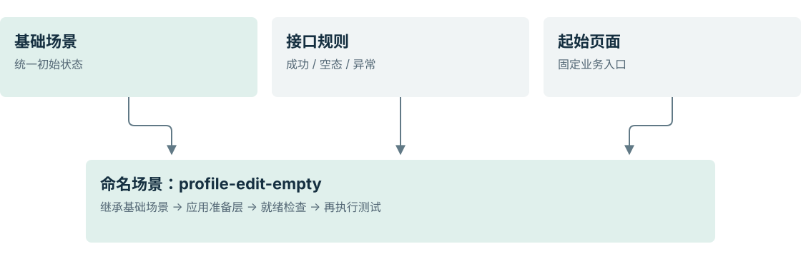
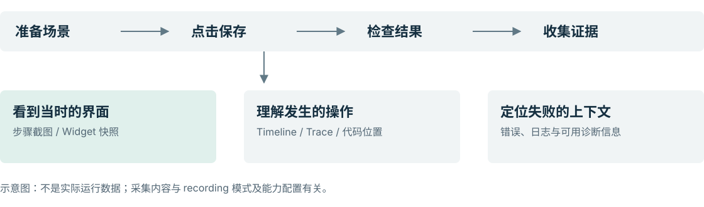
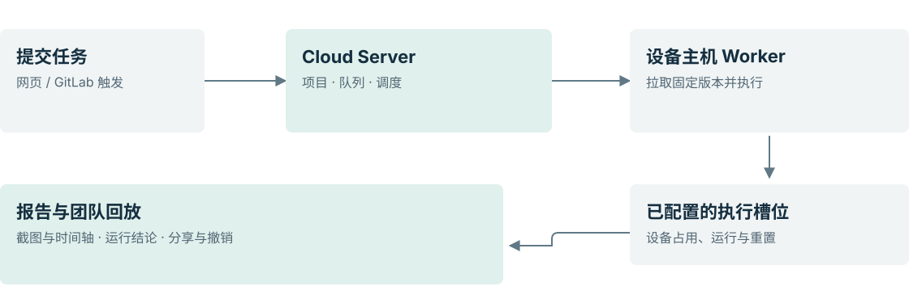
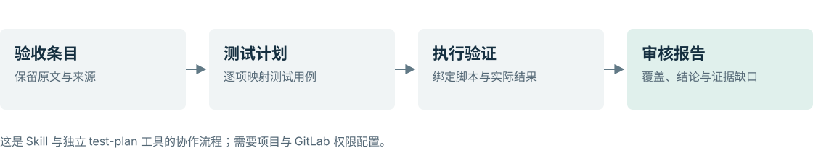

# Fliwright 产品功能分享

以当前仓库源码和实现文档为依据，面向同事介绍功能与使用场景。建议分享时长约 15–20 分钟，按现场讨论调整。

- [图文演示版](index.html)：离线打开，支持连续阅读、演示切页、方向键翻页及打印。
- [PDF 分享版](Fliwright-产品功能分享.pdf)：适合直接发送同事。
- 本 Markdown 与 figures/ 下的 SVG 为可编辑资料；HTML 图表均已内嵌，单独发送也能离线阅读。

## 01 · 让 Flutter 业务流程，变成可执行、可复盘的团队资产

Fliwright · 产品功能分享

Fliwright · Flutter 自动化运行时与测试工具链

从业务操作到可复用自动化，再到运行证据与团队协作。

### 给谁看

Flutter 开发、测试、产品、设计与研发效能同事。

### 一句话理解

通过 TypeScript 操作已接入的 Flutter App；加入断言后成为测试，并保留运行证据。

当前仓库工作区快照 · 2026-11-09 · Developer Preview
介绍已实现功能；发布可用性与平台范围以对应版本及验收记录为准。图中业务案例均为示意。

来源：[S01](#s01), [S02](#s02)。

## 02 · 把重复操作，变成可以复用的流程

从“每个人手动再做一遍”，走向“用同一套流程执行、验证和讨论”。

| 常见协作问题 | Fliwright 提供什么 | 谁直接受益 |
| --- | --- | --- |
| 修改后反复点击相同业务路径 | TypeScript 自动化脚本、断言与重复执行 | 开发 / 测试 |
| 空数据、异常返回和特定用户状态难复现 | 命名场景、Mock 规则和 App 自有状态准备 | 开发 / 测试 |
| 失败时只知道“没通过”，缺少上下文 | 步骤、截图、快照、错误与 Trace 证据 | 开发 / 测试 |
| 测试结果只在执行者电脑上 | 离线 HTML 报告、Cloud 回放与受控分享 | 产品 / 设计 / 全团队 |
| 多人争用设备，运行状态不透明 | 团队队列、Worker 槽位与设备管理 | 测试 / 效能 / 管理者 |

**产品价值** 把操作过程、运行环境和结果证据连在一起，让业务验证可以重复，也方便同事一起检查。

来源：[S01](#s01), [S07](#s07), [S09](#s09)。

## 03 · 功能全景：覆盖自动化的六个环节

CLI 是主要执行入口；VS Code 提供日常工作界面；Cloud 提供团队运行与协作。

六组能力按业务工作环节组织；不表示依赖关系或覆盖率。

### 同一套运行时

脚本、测试、编辑器和云端执行复用底层自动化能力。

### 按需求选配

网络 Mock、Riverpod、原生设备能力和 Cloud 按项目接入；AI / Flow / Design QA 属于实验方向。

来源：[S01](#s01), [S02](#s02), [S08](#s08), [S09](#s09), [S18](#s18)。

## 04 · 它怎样理解并操作 Flutter App

App 接入 Bridge 后，工具可读取 Widget 语义与上下文，使用定位器执行操作并检查结果。

主要通路：使用入口 → 自动化运行时 → App 内 Bridge → Flutter 页面；原生 UI 为独立可选通路。

**接入前提** 团队需要控制 App 源码，在专用调试 / 测试入口启用 Bridge，并提供可访问的 VM Service；Release 模式下 Bridge 不启用。

来源：[S01](#s01), [S02](#s02), [S03](#s03), [S17](#s17)。

## 05 · 从一次操作，沉淀成可维护的自动化

录制帮助搭建流程；业务断言与真实回放决定它能否成为可信回归测试。

录制 → 生成候选代码 → 确认断言与场景 → 回放验证；失败或缺少证据时继续保留草稿。

### 脚本：完成任务

例如打开某页、填写表单、重复准备演示环境；流程不一定需要测试断言。

### 测试：判断业务对错

在操作之后检查“保存成功”“值已持久化”等可观察结果；缺少确认断言不能当作已验证测试。

**录制的输出** TypeScript 为主要路径；另有 Dart 生成能力，Dart 的验证需要独立的编译 / 回放证据。

来源：[S04](#s04), [S08](#s08)。

## 06 · 同一套业务流程，可以切换不同场景

用命名、可继承的 TestScenario 声明环境，减少测试各自拼装前置条件。

示意：组合基础状态、接口规则和起始页面，形成可复用命名场景。

### 适合准备什么

存储种子、登录身份、App 能力、状态适配、Mock、路由和就绪检查。实际可用项取决于 App 接入。

### 身份如何准备

已登录业务测试通过 App 自有的 auth.seedLoggedIn 注入测试身份；登录流程本身单独验证。

设备权限、媒体、相机等声明有独立平台与接入限制，类型存在不代表端到端可执行。Cloud 构建器当前主要组合 Mock 与起始路由，导出配置后需提交仓库。

来源：[S05](#s05), [S12](#s12), [S17](#s17)。

## 07 · Mock：让难复现的数据情况稳定出现

可选的 HTTP / WebSocket Mock，让同一业务路径在不同返回数据下重复验证。

请求命中已启用的 Mock 规则后，使用指定响应；示意不代表所有网络栈自动接管。

| 示例规则 | 用户会看到什么 | 建议验证什么 |
| --- | --- | --- |
| profile-success | 正常用户资料 | 字段显示正确，允许编辑 |
| profile-empty | 资料为空或缺失 | 空态文案、占位与可用操作 |
| profile-error | 读取或保存失败 | 错误提示与重试入口 |

**复用与断言** 规则以 JSON 维护，可组合共享与专项规则，并检查请求是否发生及其参数。直接运行且未选场景时，Cloud 不自动加载 Mock。

来源：[S02](#s02), [S06](#s06), [S09](#s09)。

## 08 · 失败后，沿着证据回到具体一步

运行结果之外，还能查看步骤和上下文，帮助团队讨论“在哪里、为什么失败”。

执行步骤与证据关联：截图、快照、Timeline、Trace 和错误上下文。

### 本地复盘

CLI 与 VS Code 查看运行记录；从保存的结果生成可离线打开的 HTML 报告，无须重跑 App。

### 团队查看

Cloud 按已归档步骤与截图回放，支持拖动时间游标和只读分享；这不是连续视频录屏。

业务结论与证据完整性分别展示：测试通过不代表证据齐全；中断、缺图和部分证据应保留其真实状态。

来源：[S07](#s07), [S08](#s08), [S11](#s11)。

## 09 · 团队云测：把设备、队列和报告集中起来

Cloud 自托管部署；Worker 运行在连接设备的电脑上，两者独立安装与运行。

网页或 GitLab 提交 → Cloud 队列 → Worker 与执行槽位 → 报告发布与分享。

**设备发现 ≠ 可调度** iOS / Android 真机与模拟器可被发现；执行还需纳管、启用、应用授权、在线设备、空闲槽位和匹配 Worker 进程。

来源：[S09](#s09), [S10](#s10), [S11](#s11)。

## 10 · 让验收标准、测试和报告有据可查

可选 GitLab 测试计划工作流，把需求条目与实际验证连接起来。

GitLab 验收条目 → 测试计划 → 已绑定用例 → 运行证据 → 审核报告。

| 参与者 | 在这条链路上关注什么 |
| --- | --- |
| 产品 / 业务 | 每条验收标准是否有对应验证，哪些仍有疑问 |
| 测试 / 开发 | 具体用例、Mock、脚本及真实运行证据是否对应 |
| 发布负责人 | 构建信息、覆盖与证据是否齐备，阻塞项是否已处理 |

**审批边界** 测试计划工具不负责运行 App 或批准发版；报告提供事实与缺口，最终发布决策由团队负责。

来源：[S07](#s07), [S13](#s13)。

## 11 · AI 与设计联动：作为可选的增强层

编码 Agent 可通过 Skills 与 CLI 操作工具；实验能力需要配置和人工检查。

查看上下文 → 辅助分析或生成候选 → 人工检查 → 确定性回放与断言验证。

| 增强方向 | 当前能做什么 | 使用边界 |
| --- | --- | --- |
| AI 辅助 | 通过 Codex / Claude / 自定义 CLI 适配辅助分析 | 默认无 AI provider；需显式配置 |
| Flow / Figma | 流程文档、节点绑定、截图采集与对比报告 | Labs；需有效绑定和采集证据 |
| 持续 TDD | 聚焦测试与 Flutter 同步的开发循环 | Labs；依赖本地运行环境 |

核心操作与常规测试可在不配置 AI 的情况下运行；修复建议、自愈结果和视觉差异均需结合业务断言判断。

来源：[S01](#s01), [S14](#s14), [S15](#s15)。

## 12 · 能力边界：先认清范围，再选择接入

当前为 Developer Preview。下面区分已有能力、选配条件与仍需专项验收的范围。

| 能力 | 当前定位 | 同事需要知道的条件 |
| --- | --- | --- |
| 定位 / 操作 / 断言 / 运行证据 | 核心 | 需要 Bridge 与可信调试 / 测试构建 |
| 录制与代码生成 | 已有能力 | 可靠测试仍需稳定目标、断言和候选回放验证 |
| 网络 Mock / Riverpod / VS Code | 可选集成 | 按项目接入；Riverpod 写入需要明确可写注册 |
| Cloud / Worker / GitLab 触发 | 已有独立部署能力 | 身份、仓库、设备、重置和部署链路需本地验收 |
| ADB / XCTest 原生 UI | 可选能力，按平台验收 | 模拟器已有受控验证；真机与具体系统场景单独确认 |
| 设备权限 / 相机 / 生物识别 | 受限能力 / 专项接入 | 不承诺各平台声明均可端到端执行 |
| AI 修复 / TDD / Flow / Design QA | Labs | 启用与平台适配需配置；输出需审阅和验证 |

Android / iOS 模拟器及 macOS 各有已验证切片；不能据此推断所有平台、手势、输入法或真机均已完整支持。版本与平台细项参见兼容性记录 [S16]。

来源：[S01](#s01), [S08](#s08), [S09](#s09), [S16](#s16), [S17](#s17)。

## 13 · 建议用一个完整业务故事做首次分享

演示脚本示例：编辑资料并保存；用三种返回数据说明功能，而不是逐条讲 API。

**01**

### 先看操作

录制打开资料页、编辑字段和保存的过程。

**02**

### 再看验证

确认“重新打开仍显示已保存值”的业务断言并回放。

**03**

### 切换场景

使用成功、空态、错误三组 Mock，执行同一业务路径。

**04**

### 共同复盘

查看一次失败的步骤、截图和错误，打开离线报告。

**演示准备** 示例需要在目标 App 中接好 Bridge、业务 Key、命名场景、规则与断言；此文档没有执行该业务案例。Cloud 展示可作为进阶环节。

### 团队落地顺序

**第一步 · 本地闭环** 选择一个关键流程，跑通成功与失败；确认截图和报告可读。

**第二步 · 资产复用** 版本管理测试、场景与 Mock；明确谁维护断言和测试数据。

**第三步 · 团队运行** 接 CI 或 Cloud；配置设备、Worker、身份与报告分享。

来源：[S01](#s01), [S04](#s04), [S05](#s05), [S07](#s07), [S09](#s09)。

## 14 · 资料来源

以下路径相对于仓库根目录；优先以当前源码与对应版本验收记录核对。

- **S01 · 产品定位与能力分层**：[源码 / 实现文档](../../../README.md)

- **S02 · Flutter 运行时与公开入口**：[源码 / 实现文档](../../../packages/fliwright-core/src/index.ts)

- **S03 · 定位、页面与操作**：[源码 / 实现文档](../../../packages/fliwright-core/src/Page.ts)

- **S04 · 录制生成与发布验证**：[源码 / 实现文档](../../../packages/fliwright-core/src/RecordingReadiness.ts)

- **S05 · 命名场景、继承与环境分层**：[源码 / 实现文档](../../../packages/fliwright-core/src/Scenario.ts)

- **S06 · Mock 规则集与组合**：[源码 / 实现文档](../../../docs/features/mock-rule-set-pipeline.md)

- **S07 · 离线报告与证据完整性**：[源码 / 实现文档](../../../packages/fliwright-cli/src/commands/artifact-report.ts)

- **S08 · VS Code 工作流**：[源码 / 实现文档](../../../packages/fliwright-vscode/README.md)

- **S09 · 团队云测、设备、权限与部署**：[源码 / 实现文档](../../../packages/fliwright-cloud/README.md)

- **S10 · Worker 执行与设备主机**：[源码 / 实现文档](../../../packages/fliwright-cloud-worker/README.md)

- **S11 · Cloud 报告回放**：[源码 / 实现文档](../../../docs/features/cloud-replay-pipeline.md)

- **S12 · Cloud 场景构建器**：[源码 / 实现文档](../../../docs/features/cloud-scenario-builder-pipeline.md)

- **S13 · GitLab 验收计划与覆盖追踪**：[源码 / 实现文档](../../../packages/test-plan/README.md)

- **S14 · AI 默认配置与启用条件**：[源码 / 实现文档](../../../packages/fliwright-core/src/ai/config.ts)

- **S15 · Flow 与 Figma 命令入口**：[源码 / 实现文档](../../../packages/fliwright-cli/src/registry/flow.ts)

- **S16 · 平台、版本与实际验收边界**：[源码 / 实现文档](../../../docs/release/compatibility.md)

- **S17 · 原生设备会话**：[源码 / 实现文档](../../../docs/features/native-session-pipeline.md)

- **S18 · 表单自动填写**：[源码 / 实现文档](../../../docs/features/form-fill-pipeline.md)

本文独立于自动生成的 `docs/features/`，更新产品介绍时无需清空或重建实现索引。本文未运行演示业务案例，不作量化提效或全平台覆盖承诺。
