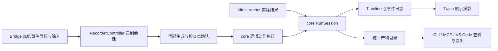

# 自动化执行与过程记录闭环补全设计

- 日期：2026-10-16
- 状态：Proposed；设计稿，尚未实施
- 范围：bridge、core、Vitest、CLI、MCP、VS Code，以及真实 App 验收
- 依据：2026-10-16 源码分析与真实 macOS Flutter App 验收；执行成功、默认动作缺失、失败 Trace 状态错误、跨页录制回放失败、证据导出不完整

## 1. 完成后的用户体验

1. 开发者编写普通 locator 操作和断言，运行后自动得到动作顺序、目标、耗时、截图和最终结果；无需为留痕给每个动作手写 flow.step。
2. 测试失败后，报告、Timeline、Trace、IDE 显示一致的测试结果，并能找到失败位置和当前或最近可用的界面证据。
3. 人工录制跨页操作后，得到保持正确目标、输入内容和操作顺序的脚本；确认业务检查点并通过确定性回放后，成为可回归测试。
4. 导出一次运行，复制到另一个路径或机器后仍可独立查看其过程和证据。
5. 初始化、录制、命令行运行、MCP 和 VS Code 使用同一配置及目录约定。

“完整”指 Fliwright 控制范围内的逻辑动作、检查点与可用证据，不承诺视频、原生系统弹窗操作或自动理解任意业务正确性。操作系统强杀、VM 失联等情况下，明确标为 interrupted/partial，并展示最后已保存的证据。

## 2. 总体架构与约束

复用现有 TimelineRecorder、TimelineNodeLifecycle、TimelineArtifactStore、RecorderController、SelectorQuery、Flow、TestScenario 和 Run Viewer，不另建一套录制展示系统。



主要分工：

| 归属 | 职责 |
| --- | --- |
| bridge | 事件发生时的目标、焦点、时间和输入；复用真实 selector 匹配器验证目标；截图与语义采集 |
| core | 逻辑动作生命周期、录制聚合、失败归一化、证据调度、产物引用、代码生成、配置值模型 |
| Vitest | 将 runner 的实际 task/attempt/hook 结果交给 RunSession；提供现有 test/script fixtures |
| CLI / MCP | 调用公共流程，传递配置、取消信号和输出位置，输出同一结果模型 |
| VS Code | 录制审阅、确认断言、触发回放、运行与证据浏览；消费公共模型 |

不增加框架或独立 package，不增加逆向跨包依赖。配置的文件加载保留在已有集成位置，公共类型、默认值、校验和合并规则归 core。旧设计与本文冲突时，实施以本文为准：特别替换停止后 live hitTest、位置兜底即宣称可靠、Trace 自行推导最终状态、兄弟目录存储、仅靠 TODO 建议生成测试的行为。首版不做旧目录双写或双读；旧产物如需迁移，单独提出迁移工作。

## 3. 自动运行过程记录

### 3.1 默认策略

新增统一配置 `recording.mode: 'standard' | 'full' | 'off'`，默认 `standard`。现有 Trace 模式和目录不再作为独立控制开关；Trace 是记录数据的展示形式。实施时更新调用方和环境变量，避免同时存在两套优先级。

| 内容 | standard（默认） | full | off |
| --- | --- | --- | --- |
| 测试最终结果、错误及产物完整性 | 保存 | 保存 | 保存最小报告 |
| 所有逻辑动作、断言、显式业务分组 | 保存 | 保存 | 不生成过程记录 |
| 动作后截图 | 每次逻辑动作一张 | 每次逻辑动作一张 | 不采集 |
| 动作前截图与语义快照 | 不默认采集 | 采集 | 不采集 |
| 测试开始和结束截图 | 采集 | 采集 | 不采集 |
| 失败截图、快照、诊断 | 立即采集 | 立即采集 | 不采集，报告标明关闭 |
| 业务 flow.frame | 按显式选项采集 | 按显式选项采集 | 显式调用仍执行，标明为用户请求 |

“逻辑动作”包括 click、fill/type/clear、longPress、drag、选择控件、导航、键盘操作及复合 helper 的公开调用。一个复合调用的内部重试、resolve、settle、截图 RPC 不重复生成同等级动作或重复截图。纯读取不自动生成动作节点；显式 frame/检查点照常记录。等待与跳过的条件操作保留单个节点及最终状态，不把每次轮询写成一项操作。

`flow.step()` 和 `flow.page()` 继续提供业务名称和父子结构；其内部 action 节点仍自动产生。生成器可以输出业务 step，但不需要额外插入 flow.frame 才能拿到默认动作截图。

### 3.2 记录位置和内部 Interface

core 增强 Page/Locator 的执行上下文，使用一个内部操作执行入口包裹完整公开操作，覆盖定位、actionability、bridge 返回结果检查与最终异常。不能只在 sendRequest 的 finally 中观测。

拟议内部 Interface：

```ts
interface RunSession {
  perform<T>(operation: OperationDescriptor, execute: () => Promise<T>): Promise<T>;
  checkpoint(request: EvidenceRequest): Promise<EvidenceResult>;
  finish(outcome: RunnerOutcome): Promise<RunResult>;
}
```

- `perform` 复用 TimelineNodeLifecycle，统一处理节点、耗时、目标、源位置、证据和失败；Promise 返回与异常行为保持调用者所请求操作的语义。
- Page、Locator、Driver getter 和 helper 共用上下文，清除 Vitest 中动态替换 sendRequest、重置私有 `_page` 的做法。
- 低层手工 `driver.sendRequest` 的可识别动作记录为 raw action；若处于已有逻辑动作中，仅作为子事件。解析 bridge 的 `{success:false,error}`，不能仅判断 transport 是否抛错。
- 使用运行上下文中的 operationId/parentId 区分嵌套和重试；用 AsyncLocalStorage 隔离并发分支，替换 TimelineRecorder 共享可变栈对异步分支的隐式依赖。
- 同一 App endpoint 的动作和证据采集占用同一执行租约，直到截图完成才放行下一操作。允许不同 App 并行；同一 App 的测试串行。租约在规范化 endpoint 上跨 worker/进程生效，并随取消、退出释放；嵌套动作可重入，不能递归等待自身。不得用一个全局 driver 接受不同测试并行操作。
- 捕获失败不能替换原始操作错误。明确标记 evidence 为 partial，并保存采集错误。

### 3.3 Trace 的定位

Timeline/事件日志记录事实，TraceCollector 改为消费相同 operationId 和结果的投影，保留现有 Trace UI 所需的展示模型。一次动作只执行、判定和采集一次。Trace 的 action 状态来自该动作结果，Trace 顶层测试状态来自 runner 最终结果，两者允许不同，例如“所有点击成功，但断言失败”。

## 4. 人工录制可靠性

### 4.1 在动作之前固定目标

仅把停止后的解析前移到 Node 收到事件时仍存在 VM 往返竞态，不能满足跨页场景。

bridge 在指针分发进入业务回调之前冻结目标信息：可交互控件、稳定 key/semantics、祖先路径、候选 SelectorQuery、匹配数量、route、viewport、frameId。指针 up 继承 down 的 targetId，不能再次从新页面选择目标。

可靠捕获采用测试专用 `FliwrightRecordingBinding`，在 Flutter pointer dispatch 调用 `super` 前读取 hit-test path/Element 信息；启动入口明确初始化该 binding。`init` 生成的测试入口提供正确顺序。若 App 已初始化不兼容的自定义 binding，能力检查给出不可录制的明确原因和接入方式，不能静默降级成最终页面 hitTest。执行普通脚本仍按其实际 bridge 能力检查。

抽取 InspectExtension 中 selector 解析/匹配的内部 Dart helper，由实时查询与录制目标验证复用。候选生成和同帧唯一性检查都在 bridge 完成；Node 的 RecordedSelectorResolver 改为校验和选择事件内的候选，不再实时请求历史坐标。同步捕获设置遍历上限，只在 down/焦点变化时采集；超出预算或找不到目标应标 unresolved，不得伪造目标。

选择优先级：显式 key → semantics identifier → 带控件角色的稳定 label/tooltip/text → 带稳定祖先的组合 query。记录匹配计数与稳定性级别。位置 nth 可保存到草稿中供审阅，但不能单凭 nth 标为 durable。没有可靠 selector 时保留坐标操作草稿和阻塞原因。

截图可在事件后异步采集，其 frameId 和 captureTiming 必须保留，不能把最终页面图伪装成事件前截图。必要的动作前图取已缓存帧并记录帧时间。

### 4.2 录制协议

录制握手声明协议版本与 before-dispatch target、focused-input 能力；不支持时要求升级/接入，首版不加旧事件猜测路径。

事件统一包含：

```ts
interface RecordingEventEnvelope {
  version: 2;
  sessionId: string;
  sequence: number;
  elapsedUs: number;
  frameId: string;
  targetId?: string;
  // payload 为 pointer / text / focus / route 的有判别联合
}
```

- 所有事件使用 session Stopwatch 的 elapsedUs；sequence 是接收后排序、去重及缺口检测的主依据，elapsedUs 用于时长。PointerEvent 的平台时间只允许作为诊断字段。
- 同一 session 的 targetId 识别控件实例，focusSessionId 识别一次输入会话；两者都不能写入最终测试 selector。
- 指针坐标为 Flutter logical pixels，配套 viewport 和截图 pixelRatio。duration 统一命名为 durationMs；协议转换只发生一次，代码生成不再接收无单位 duration。
- stop 先刷新输入及待发送事件，再取消监听，返回 lastSequence；core 等待接收到该 sequence 或超时标 partial，之后才结束会话与生成代码。重复事件幂等处理，序列缺口阻止“完整录制”状态。

### 4.3 输入、清空和手势

- 监听实际焦点 EditableText 的 TextEditingController，而不是 50ms 全树轮询；焦点改变时重绑、失焦/stop 时 flush，销毁时清理 listener。
- 输入事件携带对应 targetId、focusSessionId 和最终编辑值；IME composing 中间态不生成可回放输入，提交/失焦/stop 才合并。
- 最终状态录制默认生成 `fill(finalValue)`；仅在显式选择逐字模式且事件完整时生成 type。删除、选择后替换、粘贴和清空都作为有效值变化，空字符串不能过滤。
- 同一输入会话只合并连续编辑，不跨越提交、导航或另一个控件操作；输入必须排在保存点击之前。
- longPress 使用明确 durationMs；drag 保留目标、方向与必要轨迹，跨可滚动布局使用已有 scroll 能力；pinch、多指及未支持手势标明 unsupported 并阻止可靠性标签，不转换为普通点击。

### 4.4 会话状态与资源

RecorderController 保留 start/stop 作为主要 Interface，stop 返回结构化 RecordingResult，包含 operations、frames、target/sequence 诊断、代码生成结果及阻塞问题。编辑帧、重新生成、持久化消费同一结果。

会话使用 `recording → stopping → captured | partial | failed`；生成/回放状态单独记录，不能混在录制捕获状态中。CLI SIGINT 执行 stop/flush；异常、取消、MCP 超时和 VS Code 关闭都 finally 解除事件、输入 listener、sampler 和 driver 连接，确保命令退出。

## 5. 从录制脚本到业务测试

### 5.1 生成状态与默认行为

录制默认生成 `.fliwright/scripts/<name>.script.ts`，使用现有 script fixture。若请求生成测试但缺少可靠 selector 或确认的断言，则保留 `.fliwright/recordings/<id>/` 草稿与问题清单，不生成一个容易被 CI 当作通过的 `.test.ts`。

生成结果包含：

- `automationKind: script | test`；
- `readiness: draft | generated | verified`；
- 阻塞原因，如 unresolved target、unsupported gesture、missing assertion、missing scenario；
- `verifiedRunId`、内容指纹和 scenario 指纹（只有回放验证后存在）。

一份 script 也可被 verified；只有 test 同时具备确认断言、可靠目标、确定性 scenario 和成功回放才显示“可回归测试”。修改代码、selector、检查点或 scenario 会失效 verified 标签。人工 authored test 的 runner 结果不因该录制工作流标签而被改写。

### 5.2 检查点确认

复用 AssertionSuggester 和现有 flow assertion 节点，新增结构化候选：位置、目标 query、matcher、expected、来源截图/快照、建议原因和确认状态。

- 候选来自稳定界面的真实观察：目标可见、明确文本、勾选/启用状态、可获取的路由；不能根据坐标变化猜出业务成功。
- 用户可以在录制审阅界面选择最终控件并设置“Saved: …”“列表新增一条”等可观察结果；CLI/MCP 接收同一结构化确认数据。
- 用户确认的候选才生成可执行 expect；只建议不自动接受。可选 AI 负责草拟，不绕过确认，也不是录制/CI 的必需依赖。
- 持久化、接口副作用或权限结果需要项目定义的检查点，不能由“按钮点击成功”推导。
- 测试模式默认 requireAssertions=true；识别 Timeline 断言和 runner 中实际执行的 Vitest 断言，零断言不得判为有效测试。script 不要求断言。

### 5.3 回放验证与环境

回放必须显式触发，使用已有命名组合 TestScenario 描述 mocks、storage、auth、state、app、navigation 与 ready。录制结果绑定 scenario 名称和指纹。认证使用 app 自有 auth.seedLoggedIn；home reset 只处理导航，不能作为清理数据、登录和网络状态的替代。

CLI 通过 `record --mode test --scenario <name> --assertions <file> --verify` 完成显式验证；IDE 提供“确认检查点”“回放验证”“保存为测试”；MCP 返回相同 readiness/issues/verification 数据。验证失败保留原始录制与失败 run，不静默修改 selector 重跑到绿。

主交付目标为 TypeScript/Vitest。已有 Dart 输出必须明确要求 app 测试入口、必要 imports 和已安装的 integration_test；生成 app.main 启动后再操作。Dart 不支持的 SelectorQuery 或断言应返回问题，不得降级为 find.byType(Widget) 或把 role 当 semanticsLabel。Dart 通过自身编译和真实运行验收后才显示 verified，不继承 TS 的验证结果。

## 6. 失败生命周期与证据

### 6.1 结果的唯一来源

RunSession 区分 `operationOutcome`、`attemptOutcome`、`testOutcome` 和 `evidenceStatus`：

- 操作失败可能被业务代码捕获，操作节点保留失败事实，测试最终结果以 runner 为准。
- 断言失败不要求有失败动作；Trace 顶层仍是 failed。
- retry 第一次失败、第二次成功，保留两个 attempt，最终通过并标记 flaky，不覆盖第一次记录。
- skip/cancel/timeout/worker crash 不得因“没有失败动作”而被标 passed。
- `test.fails` 同时保存实际 observedOutcome 和 runner 的预期失败判定，UI 明确“预期失败”，避免隐去实际错误。

Timeline/Trace/RunResult 共用规范化状态，扩展为 running/passed/failed/skipped/interrupted。证据状态另为 complete/partial/disabled。

### 6.2 Vitest 集成

在 `@fliwright/vitest` 内提供基于当前 Vitest 4.1.11 `vitest/runners` 的 runner adapter，并提供 config preset。CLI、IDE 的直接 Vitest runner、初始化生成配置及仓库 E2E 一起使用，不能依赖用户手动复制环境变量。直接 `vitest run` 同样通过 preset 获得完整生命周期；缺少接入时给出明确配置错误，不产生伪完整记录。若项目已有 custom runner，给出组合接入 Interface 和验证要求，不静默覆盖。

按当前 runner hook 的实际顺序设计：

1. task/attempt 开始时建立 RunSession，早于 beforeEach，确保 setup 失败有记录。
2. `onTaskFinished` 在 afterEach/fixture cleanup 前读取 body/setup 结果，失败时立即采集，避免清理后只剩首页。
3. `onAfterRetryTask` 读取 afterEach/fixture/onFinished 的结果变化，必要时补充 teardown 失败证据，完成 attempt；driver 保留到证据采集结束。
4. `onAfterRunTask` 接收最终 task 结果，处理 retries/expected failure，完成测试；suite/collection/worker 错误由父进程汇总为 run 级失败。

实现要调用 Vitest 基类 hook 并保留其 assertion/snapshot 行为；不依赖“await use() 必然将测试异常抛回 fixture”这一假设。hook 排序、skip、timeout、retry 和 teardown 必须通过真实子进程的行为测试证明。

### 6.3 统一证据策略

所有终止失败，包括 locator/assertion、普通 throw、setup/teardown、timeout，都进入同一失败归一化和 EvidenceCapture 流程，复用 FailureCollector/AssertionTimeline/TimelineNodeLifecycle，删除各自分散的重复采集逻辑。

- 记录原始错误、codeRef、operationId、route 与可用 app/bridge 诊断。
- 截图、语义快照、诊断分别超时并返回 captured/unavailable/timeout，不因其中一项失败丢弃其他证据；总采集预算默认 3 秒，整个测试收尾预算 5 秒，可配置。
- 同一错误传播到 assertion/step/test 时，以 failureId 关联并复用同一组证据；按 failureId 而非错误文案去重。
- VM 失联时保留已写入的动作后图，标明这是 last-known、采集时间和原节点，不能冒充失败当时的界面。
- agentVisibleFailures 包含最终失败和可关联证据；已被捕获的操作错误作为 observed failure 保留，不自动改变 runner 最终结果。
- 不默认修复、重新点击或重试来获取截图；被动 AI 不影响原始错误或最终结果。

## 7. 单次运行与便携产物

### 7.1 目录和身份

保持现有 runsRoot 解析规则，但单次批量运行只占一个 runDir：

```text
<runsRoot>/<runId>/
  run.json
  report.json
  tests/<testId>/attempts/<attemptId>/
    result.json
    events.jsonl
    timeline.json
    trace.json
    logs/events.jsonl
    artifacts/screenshots/...
    artifacts/snapshots/...
    artifacts/diagnostics/...
```

- runId = 一次启动；testId 由相对文件、suite/test 路径及同名序号稳定生成；attemptId 包含 repeat/retry 序号。测试标题不作为唯一文件名。
- run.json 是清单与状态入口，登记所有测试/attempt 和引用，schemaVersion 显式标注；Timeline 协议更新版本。CLI 不扫描任意目录猜哪个是有效 run。
- 各 attempt 内的引用相对于 attemptDir；run/report 的引用相对于 runDir。运行上下文向各 sink 提供唯一 ArtifactStore，序列化文件不保存本机绝对路径或 VM endpoint。
- 始终写 canonical `runDir/report.json`；`run --output X` 额外输出同一报告，并标注其 artifact base 是 canonical runDir。该自定义文件是报告副本；便携交付使用 export，不改变 canonical 路径。
- 多 worker 只写各自 attempt 子目录；父进程负责合并 run.json/report.json，避免覆盖与写入竞争。

### 7.2 持久化、取消和异常退出

每个节点开始/结束后追加事件日志并串行 flush；二进制证据先落盘，再追加引用。Timeline 和 manifest 通过临时文件加原子 rename 更新。事件日志记录单调 sequence，读取可识别末尾未完整写入的一行。

正常 finish 生成完整投影；SIGINT/取消有界 flush 并标 interrupted。强杀时不能保证最后一条事件或最后截图，但已 flush 的数据可重建；父进程根据 worker 退出将未完成测试标 interrupted。IDE 发现 running 残留时显示“未完成”，不能推断成功。存在事件缺口、采集超时或日志损坏时标 partial，并列出原因。

### 7.3 导出与浏览

`artifacts show` 从 manifest 读取，不要求每个子目录都有 report。`artifacts export` 只导出清单内属于本 run 的文件，校验所有必需引用、跨目录逃逸和二进制文件存在性，复制到临时目录后再原子发布。

- 默认缺失必需文件就失败，保留原始 run 不变；显式 `--allow-partial` 才输出 partial 导出与 missing 列表。
- 导出后引用全部留在包内；查看器不回退到原机器路径。
- VS Code Run Viewer 支持打开导出的 run.json 和多测试/attempt；CLI show 在无 IDE 环境可读摘要与路径。首版不引入新的独立报告网站。
- 包内 evidence disabled/partial 与原运行保持一致；不能因复制成功就显示“证据完整”。

## 8. 入口一致性

统一默认目录：测试 `.fliwright/tests/`，脚本 `.fliwright/scripts/`，录制 `.fliwright/recordings/`，Flow `.fliwright/flows/`。runsRoot 保持项目隔离的现有位置，不强制写回仓库。

core 提供共享配置类型、默认值、schema 和合并函数；文件加载由调用方已有 loader 承担。优先级：显式本次参数 > 环境变量 > 已加载的项目配置 > 共享默认值。VM endpoint 继续使用已建立的解析策略，不在这次改造中另定义一套。

- CLI init 同步生成路径、测试入口 binding、Vitest preset、示例 test/script 和标准录制配置；已有文件不盲目覆盖，输出具体冲突位置。
- Vitest config 显式导入项目配置并传给 `fliwrightPreset(projectConfig)`，由现有 Vitest 配置加载机制处理 TypeScript；preset 向 runner/fixture 传递 scenarios/recording/runsRoot。CLI 的现有 loader 读取同一源文件。core 不引入 TS 文件加载器，Vitest 也不逆向依赖 CLI 的 loader。
- VS Code 默认 glob 从测试目录派生，显式用户 glob 保留。录制保存和测试发现共用路径配置。删除重复的 Trace 目录配置。
- CodeLens“Record After This Test”先运行指定测试，成功后启动 recorder；失败时保留失败报告且不开始录制。普通“开始录制”可独立使用。
- MCP 和 CLI record 使用同一会话清理逻辑、超时/取消信号、结构化结果及验证状态，不各自维护一套 recorder 生命周期。
- doctor 显示配置来源、runner preset、recording target-capture 能力、目录、scenario 与可用证据能力。详情属于诊断界面，日常录制流程只展示可执行的问题说明。

## 9. 实施顺序与交付切片

| 阶段 | 交付 | 前置 | 退出条件 |
| --- | --- | --- | --- |
| M0 契约与技术验证 | 确认 before-dispatch 捕获、输入监听、Vitest hook 顺序；定稿协议/schema | 无 | 导航立即销毁控件、IME/清空、body/teardown 失败均拿到正确上下文 |
| M1 运行身份与失败可信 | RunSession、runner adapter、统一 evidence、runDir/manifest、canonical report | M0 | 零动作 throw/断言/setup/teardown/timeout 的报告一致且证据可解释；export 完整可移动 |
| M2 默认过程自动记录 | Page/Locator/helper 自动动作、standard/full/off、Trace 投影、共享配置与入口默认值 | M1 | 无 flow.step 的普通脚本也有动作/截图；无重复记录；IDE/CLI/MCP 行为相同 |
| M3 录制生成与确认回放 | 录制协议、事件前目标、输入会话、手势单位、草稿/脚本/测试状态、确认断言、scenario 验证 | M0/M1/M2 | 真实跨页录制代码原样连续回放，业务反例能失败；命令正确退出 |
| M4 发布验收 | VS Code Extension Host、exio 真实业务、Android/iOS、取消/并行/强杀/导出与性能 | M1–M3 | 通过第 10 节门槛，更新真实兼容性声明 |

M0 的录制原型可与 M1 设计推进交错进行；不先堆叠录制 UI 功能。任何阶段只验收自身退出条件，不以“新增若干单测通过”替代实际用户流程。

## 10. 验收门槛

### 10.1 必须修复的既有失败

| 场景 | 必须观察到的行为 |
| --- | --- |
| 普通脚本点击两次后断言，无 flow 包装 | Timeline 有两个动作和断言；standard 有两张动作后图；不需设置 Trace 目录 |
| 所有动作成功但最后断言失败 | 报告、Trace、Timeline 的 testOutcome 都是 failed；失败节点有可用证据或明确不可用原因 |
| bridge 返回 success:false，transport 正常 | 对应 action 失败，保存原始错误、目标与证据，最终状态由 runner 判定 |
| 零动作普通 throw / beforeEach / afterEach 抛错 | 有测试或 run 级失败节点，不再出现空 Timeline 却宣称过程完整 |
| 人工录制打开表单、填写、提交后表单销毁 | selector 来自当时控件；输入先于提交；生成文件不改代码即可回放 |
| 长按 600ms、粘贴、IME、选择替换、清空、自动聚焦 | 单位正确；不漏首段输入和空值；内容及最终 UI 与录制一致 |
| 多测试、同名标题、重试 | 不互相覆盖；失败 attempt 可见；最终通过不抹去历史失败 |
| export 后移走原 run 目录并在另一目录打开 | 全部引用在导出包内，截图/快照/日志可打开，未读取原目录 |
| 使用 run --output 外部文件后 export | canonical report 存在；外部副本不影响 show/export |
| 初始化后录制并保存 | CLI、MCP 和 IDE 看到同一文件；测试无需改目录即被发现 |

### 10.2 真实 App、IDE 和反例验证

- 受控 Flutter fixture 提供计数器、双页表单、提交后销毁、滚动列表、重复文案、可配置失败、IME 输入；通过原生鼠标/键盘及设备触控产生录制事件，不能只用 bridge 合成动作代替人工录制。
- macOS 每条关键录制流程连续回放 20 次，无人工改生成代码；在至少两种窗口尺寸下重建控件树再回放。不能只对同一未重置实例重复点击。
- 为成功流程注入“保存没有生效”“出现错误文案”“目标消失”等反例，确认业务断言会失败；仅跑正例不算测试生成验收。
- exio 至少覆盖一个认证业务闭环和一个错误分支，使用命名 scenario、app-owned auth seed 与 mock；确认应用业务结果，不只看执行退出码。
- VS Code Extension Host 实测初始化发现、录制审阅、确认断言、回放验证、保存测试、失败查看和导出包打开；另验证 CLI runner 与直接 Vitest runner。
- Android/iOS 各至少通过一条输入/跨页/提交流程后，再将相应平台标为该能力已验收；没有设备结果就明确保留未验收状态。
- VM 断开、SIGINT、worker 强杀、fixture cleanup 失败、截图超时、导出缺文件均检查状态和残留资源；同一 endpoint 不发生并行交叉操作。

### 10.3 性能与数据规模

在固定测试机上测 baseline/standard/full，分别报告操作耗时、采集耗时与总体耗时；不得扣除采集开销后宣称无性能影响。M0 建立基线，初始目标为 standard 截图附加耗时 P95 ≤ 300ms、10 分钟录制稳定、1,000 动作后截图/原始事件缓存仍受固定预算约束。Timeline 元数据可随动作数增长；大体积二进制证据及时落盘，不长期持有 base64。不能达标就改采集实现或明确调整指标，不静默降低截图频率。

证据超时、预算耗尽和手动关闭都在清单中可见。敏感输入使用已有掩码策略并将回放值参数化，避免为了回放把密码硬编码进生成文件；截图按项目配置处理，不能声称文本掩码自动覆盖图像。

协议、selector 和 codegen 改动必须有确定性回归测试；runner 行为必须有真实 Vitest 子进程验证；跨端能力必须有真实 Flutter 验收。完成后执行对应 pnpm/melos 检查，必要的 harness 校验，以及生成式 feature docs 更新。当前文档设计阶段不运行这些实现检查。

## 11. 首轮工作包

首轮建议实施 M0 + M1：先保证结果与证据可信，并统一产物模型。该模型是默认自动记录、可靠回放和 IDE 展示的共同基础。M0 同时验证侵入性较高的 recording binding 与 runner hook，避免到实现末期才发现采集时机不成立。

首轮交付不承诺录制自动理解业务。最终闭环的发布标准是：真实用户流程可录、可确认、可回放、反例可失败、过程可查看、证据可携带，每一项都有对应运行证据。

## 12. 实施入口与历史设计

下列为现有源码，本文提出的新 Interface/字段/状态不能据此当作已经实现：

| 工作 | 当前主要入口 |
| --- | --- |
| 指针、输入与目标冻结 | [recording.dart](/Users/leo.he/projects/fliwright/packages/fliwright-bridge/lib/src/extensions/recording.dart)、[inspect.dart](/Users/leo.he/projects/fliwright/packages/fliwright-bridge/lib/src/extensions/inspect.dart) |
| 聚合、选择器与生成 | [RecorderController.ts](/Users/leo.he/projects/fliwright/packages/fliwright-core/src/RecorderController.ts)、[EventAggregator.ts](/Users/leo.he/projects/fliwright/packages/fliwright-core/src/EventAggregator.ts)、[RecordedSelectorResolver.ts](/Users/leo.he/projects/fliwright/packages/fliwright-core/src/RecordedSelectorResolver.ts)、[CodeGenerator.ts](/Users/leo.he/projects/fliwright/packages/fliwright-core/src/CodeGenerator.ts) |
| 逻辑动作与 Trace | [Page.ts](/Users/leo.he/projects/fliwright/packages/fliwright-core/src/Page.ts)、[Locator.ts](/Users/leo.he/projects/fliwright/packages/fliwright-core/src/Locator.ts)、[Driver.ts](/Users/leo.he/projects/fliwright/packages/fliwright-core/src/Driver.ts)、[TraceCollector.ts](/Users/leo.he/projects/fliwright/packages/fliwright-core/src/TraceCollector.ts) |
| Timeline 与证据持久化 | [TimelineRecorder.ts](/Users/leo.he/projects/fliwright/packages/fliwright-core/src/timeline/TimelineRecorder.ts)、[TimelineNodeLifecycle.ts](/Users/leo.he/projects/fliwright/packages/fliwright-core/src/timeline/TimelineNodeLifecycle.ts)、[TimelineArtifactStore.ts](/Users/leo.he/projects/fliwright/packages/fliwright-core/src/timeline/TimelineArtifactStore.ts)、[AssertionTimeline.ts](/Users/leo.he/projects/fliwright/packages/fliwright-core/src/assertions/AssertionTimeline.ts) |
| Vitest 生命周期 | [index.ts](/Users/leo.he/projects/fliwright/packages/fliwright-vitest/src/index.ts) |
| CLI 与便携产物 | [run.ts](/Users/leo.he/projects/fliwright/packages/fliwright-cli/src/commands/run.ts)、[artifacts.ts](/Users/leo.he/projects/fliwright/packages/fliwright-cli/src/commands/artifacts.ts)、[init.ts](/Users/leo.he/projects/fliwright/packages/fliwright-cli/src/commands/init.ts) |
| MCP 与编辑器 | [record.ts](/Users/leo.he/projects/fliwright/packages/fliwright-mcp/src/tools/record.ts)、[RecorderService.ts](/Users/leo.he/projects/fliwright/packages/fliwright-vscode/src/recording/RecorderService.ts)、[RunViewerService.ts](/Users/leo.he/projects/fliwright/packages/fliwright-vscode/src/runviewer/RunViewerService.ts) |

相关旧设计：[Timeline](/Users/leo.he/projects/fliwright/docs/superpowers/specs/2026-06-18-ai-native-timeline-agent-design.md)、[录制选择器](/Users/leo.he/projects/fliwright/docs/superpowers/specs/2026-06-15-recorder-specific-selectors-design.md)、[录制交互可视化](/Users/leo.he/projects/fliwright/docs/superpowers/specs/2026-06-13-recording-interaction-visualization-design.md)。本文 Proposed 期间不改写旧设计状态；实施时同步标明被替换的具体约定。
