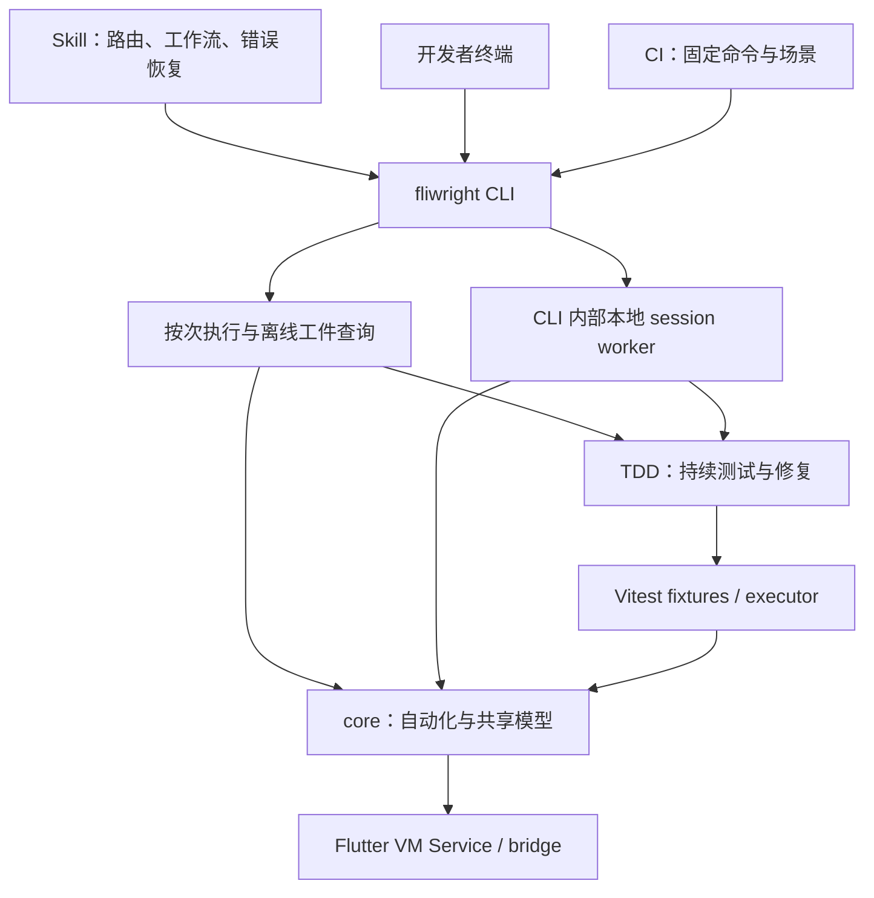

# Fliwright：移除 MCP，统一 Skill + CLI + CI

日期：2026-10-17；2026-10-18 基于 `45e3f14` 重新评估（Asia/Hong_Kong）
状态：产品方向已由用户确认；本文为设计与代码 review，尚未实施。
范围：移除自有 `@fliwright/mcp`，迁移其全部有效能力；优化 Skill + CLI 工作流，CI 为一等调用方。

本轮更新已纳入统一 capture/replay/run artifacts 的实现。当前结论与逐项证据见 [重新评估](../../plans/2026-10-18-skill-cli-reassessment.md)。迁移应复用已有 runner、结果契约、工件与 endpoint lease，重点补 CLI 外部契约和持续工作流；不再把这些底层能力列为待重建项。

## 1. 决策与依据

选择 CLI 为唯一受维护的外部执行入口，Skill 负责工作流指导，TypeScript API 负责可编程自动化。移除 MCP 包、配置、server/tool/resource contracts 和发布链路，不保留 `mcp serve` 兼容壳，也不长期维护双入口。

“全部移到 CLI”指所有用户能力都可从 CLI 访问；自动化原语仍属于 core，Flutter instrumentation 仍属于 bridge，持续测试语义仍属于 TDD。不要把这些实现复制进 CLI，也不要把 MCP 的 ServerState 改名后整体迁入 core。

这是基于目标调用方的收敛：本地有 shell 能力的 coding agent、开发者终端和 CI。MCP-only 客户端不再是本产品承诺的入口；未来若重新需要远程标准集成，应单独提出需求，不为假设中的客户端预留新的适配器。

一手资料支持这一方向，但不支持“MCP 已过时”：Microsoft Playwright CLI 与 MCP 两个官方 README 都推荐 coding agent 使用 CLI + SKILLS，同时保留 MCP 的适用场景。Anthropic 的资料强调按需发现、代码编排和结果过滤，后端仍可使用 MCP。详见 [趋势研究](../../plans/2026-10-17-cli-mcp-trend-research.md)。

本文取代 [2026-09-15 双入口建议](../../plans/2026-09-15-mcp-cli-product-surface-research.md) 对本次产品选择的指导。变化来自用户明确选择 Skill + CLI + CI，不能将前后差异解释为 MCP 协议退役。也不能借用其他产品的 token 节省百分比预测 Fliwright 收益。

## 2. 当前 CLI 能力 review

事实来源是 `packages/fliwright-cli/src/index.ts`、command/capability 实现与 MCP 注册代码，而非历史 README。MCP 源码共注册 **55 个不同 tool**，另有一个 latest test report resource；默认 profile 只注册其中 8 个工具，完整迁移须盘点全部 profile。

| 领域 | 现有 CLI | 迁移判断 |
| --- | --- | --- |
| 初始化/环境 | `init`、`doctor` | 已有入口；doctor 缺机器输出与严格退出语义 |
| 测试执行 | `run`，文件/名称筛选，pretty/json/ai-json/junit；runner errors、close code/signal、SIGINT/AbortSignal、attempt recovery、canonical report | 复用现有执行器；仍缺全程 deadline、SIGTERM、统一机器契约和退出码 |
| 脚本执行 | 显式 `run --test FILE.script.ts` 已覆盖文件发现，复用 script fixture | `script` 仅新增语义入口；不新增执行引擎，默认回归发现仍只跑 tests |
| App 交互 | `app status/observe/interact/screenshot` | 六类 interact 与扩展 action 已覆盖；每次连接并释放，缺完整 snapshot/find、source-map、debug bundle、诊断命令 |
| Scenario | `scenario list/apply/reset` | 缺 resolve；reset 是固定操作集合，不是任意命名场景的完整逆操作；managed-start 标签本身不负责启动 app |
| Mock | `mock start/list/status/apply/clear/calls`，旧 `mock:start` | 入口存在；状态查询、跨命令读取及清理语义需纠正 |
| 工件 | `RunSession`、manifest、attempt evidence/journal；`artifacts show/export` 支持 manifest-only、portable paths、partial export | 复用已有事实层；缺 failure/timeline 节点查询、诊断与 AI diagnosis 的 CLI |
| 录制 | `record --mode script\|test`、scenario/checkpoints、draft/generated/verified、`--verify`、TS/Dart 和 flow；共享 capture 已负责 flush/dispose | CLI 仍面向 Ctrl+C；只需接出已有 duration、纯机器结果；跨命令 start/stop 是增强项 |
| TDD（Labs） | `tdd cycle/sync/status` | cycle/sync 是 start→focus/operate→stop；不是 MCP 的持续 runtime；缺 prepare/validate/focus/repair/reconnect/scenario |
| Flow（Labs） | list/get/bind-figma/agent-spec/clean/review-plan/review-bundle/review-capture-figma/review-report/generate-test/validate | 较完整；缺 runtime capture 和一键 review run |
| 表单 | CLI 导出 form capabilities | 是代码入口，尚无终端命令；现有 MCP action 也未直接完整暴露表单 helper |
| Skill/plugin | 作者 Skill、MCP workflow、Flow/TDD Skill、plugin manifest | 多处仍依赖 MCP profile/tool 名；部分 CLI reference 已明显落后于源码 |

### 2.1 需要优先解决的 review 发现

**[P1] `mock status` 会改写 app，而非仅查询。** `commands/mock-management.ts:20` 调用 `driver.mock.loadRules()`；`core/MockManager.ts:164` 起的实现会把加载出的 active rules 应用到 Flutter。执行 `mock apply /endpoint error` 后再查询 status，重新加载可能将路由改回文件里的默认规则。新 status 必须分别查询文件 catalog 与真实 app 状态，不注入规则。

**[P1] 独立 `mock calls` 会读新 manager 的本地空记录。** `mock-management.ts:52` 每次创建新 driver，直接调用 `getCalls()`；新 `MockManager` 的 `usesFlutterStore=false`，`getCalls()` 选择本地 ToolMockServer，driver.connect 不切换该标志。之前 Flutter 请求不能因此被正确读取。应建立明确的 Flutter calls 查询能力，避免借助会应用规则的 `loadRules()` 来切换后端。

**[P1] 不能把 `mock clear` 当作 MCP `clearCalls` 的替代。** CLI 当前清路由、调用历史并打开 passthrough；MCP clearCalls 只清历史。目标接口分别提供 `mock clear-calls` 与 `mock reset`，并在 schema 标记其效果。

**[P1] 生命周期缺口会丢失持续能力。** app 命令的 `withAppSession()` 在 finally dispose；TDD cycle/sync 每次停止 runtime。磁盘 status 不能序列化 driver、stream subscription、Vitest executor 或 Flutter daemon 控制权。必须为持续诊断、TDD 与 devassist 提供明确的本地 session 生命周期；有界录制已经是单次命令，不依赖新增 worker。

**[P1，设计约束] 不得让 session 父进程持 endpoint lease 等待 fixture。** core 已有 `EndpointLeaseManager`，Vitest 在 fork worker 的 task preparation 获取 lease 并覆盖 setup、执行、取证与重试。父进程若持同一 lease 等待 rerun，子进程等待父锁，形成死锁；AsyncLocalStorage 的可重入语义不跨进程。复用此机制，先定义阶段交接；若要求整个 sync/reset→rerun 原子化，再在 core 实现并验证显式跨进程授权，不能另造 CLI 锁绕过。

**[P2] `--json` 尚不是完整机器契约。** 一部分 app/scenario/mock 命令即使未传 `--json` 也总输出 JSON；异常经 `exitWithError()` 输出纯文本，退出码统为 1。Commander 参数错误及数值转换也绕开统一 renderer。agent 无法稳定区分参数错误、测试红灯与环境失败。

**[P2] 未知 interact operation 可以静默结束。** Commander 的 `<operation>` 是任意字符串，action 直接传给 `appInteractCommand()`；其 switch 无 default。传未知操作会先连接 app，随后返回 undefined，没有动作也没有失败。类型声明不能代替运行时校验；目标必须在连接前校验 operation/action/枚举、正数范围和互斥参数，未知操作 exit 2。

**[P2] run 还缺整条命令的 deadline 与 SIGTERM 契约。** 现实现已保留 runner collection/suite/unhandled/process errors、close code/signal，并支持 AbortSignal、SIGINT、POSIX process-group 清理及升级 SIGKILL。不能重复建设这些能力；`--timeout` 仍是 per-test timeout，尚不能约束挂住的启动/收尾。目标补 command deadline、SIGTERM 与稳定错误/退出码映射。

**[P2] doctor 的诊断不等于 CI gate。** 当前已验证共享 config/paths、录制 preset、bridge protocol/输入捕获与 evidence channel；仍只打印检查并返回数组，未据关键检查失败设置非零退出码。Node 检查阈值是 18，而 package engines 是 >=20。目标区分 required/optional/skipped，支持 `--json --strict` 和确定性的探测测试。

**[P2] 录制的 CLI 适配尚不适合非交互调用。** core 的 `captureRecording()` 已统一 start→等待/取消→stop/flush→有界 dispose；CLI/MCP 均复用，连接失败也清理 driver。CLI 默认仍等待 SIGINT，进度、代码、提示混在 stdout，且尚未透出核心已有 `durationMs`。目标接出 duration/deadline/机器结果，保留 readiness、blockers、scenario fingerprint、确认的 assertion manifest 与严格 replay evidence；不能把 draft/generated 宣称为 verified。

**[P2] Skill 的陈旧命令示例会误导 CI。** 当前 CLI reference 只列旧的五个顶层命令、testDir 默认写成 e2e（源码为 tests）、VM precedence 与源码不同，还将 `--reporter junit --output reports/junit.xml` 写成示例；实现的 `--output` 始终写 JSON。迁移必须同时校验示例和实际 CLI，不能只替换 tool 名。

### 2.2 ref 与状态的重要事实

Flutter `ref_registry.dart` 使用静态表持有 `e<N>` / `q<N>`；ref 并非仅存在 MCP driver 内存。CLI 重连本身不会使 ref 失效，因此不能用“ref 必须 daemon”论证 session。

风险来自 app/isolate 重启、元素卸载、快照陈旧和 registry 重置后 token 复用。目标应绑定 app incarnation、isolate 和 observation 上下文，拒绝 stale ref；不能静默用 text/坐标替代。持久测试应使用 Key/semantics/query locator。session 的必要价值是长订阅、持续 recorder/executor、daemon 控制和操作协调。

## 3. 三种接口方案

### A：无驻留进程，执行单元 + artifacts

```ts
execute(request: { steps: Operation[]; deadlineMs: number }): Promise<Receipt>;
runScript(request: { file: string; deadlineMs: number }): Promise<Receipt>;
inspectArtifact(query: { runId: string; kind: string }): Promise<ArtifactResult>;
```

```sh
fliwright exec --input steps.json --json
fliwright script .fliwright/scripts/checkout.script.ts --json
fliwright artifacts failures RUN_ID --json
```

每次 connect→execute→persist→dispose，隐藏发现、场景、超时与工件。与当前 CLI 很接近，CI 简单。但独立命令之间无法保留未中断订阅、recorder、executor/baseline 和 daemon owner；前台单命令内可以持续运行，不能宣称跨命令完全等价迁移。完整 Operation union 也容易变成第二套脚本语言。

### B：语义命令 + 显式本地 session

```ts
openSession(input: SessionInput): Promise<SessionHandle>;
execute(command: CommandRequest, context: ExecutionContext): Promise<CommandResult>;
closeSession(id: string): Promise<CloseResult>;
```

```sh
fliwright session open --json
fliwright app observe --session SESSION_ID --json
fliwright app interact tap --session SESSION_ID --ref REF --snapshot --json
fliwright tdd start --session SESSION_ID --config . --json
fliwright tdd focus --session SESSION_ID --file .fliwright/tests/checkout.test.ts --json
fliwright tdd cycle --session SESSION_ID --json
fliwright session close --session SESSION_ID --json
```

CLI 包内部的 worker 保存连接、诊断订阅、录制和 TDD；agent 只调用 CLI，无需 MCP host 配置。隐藏持续状态，符合现有命令分组和常见观察→操作→验证工作流。代价是必须维护 worker 活性、版本、锁和取消；删除 MCP 消除了协议适配成本，持续 runtime 的复杂性仍然存在。

### C：TypeScript script / SDK 优先

```ts
runTask(input: { file: string; kind: 'test' | 'script'; scenario?: string }): Promise<Receipt>;
```

```sh
fliwright script .fliwright/scripts/checkout.script.ts --json
fliwright run --test .fliwright/tests/checkout.test.ts --json
fliwright schema script --json
```

复用现有 `@fliwright/vitest` script / core 编程能力，隐藏 fixture、timeline 和报告；复杂分支、循环、自定义任务直接用 TypeScript。表达力最强，避免把 SDK 每个方法做成一个 CLI。但每次单步探索都写脚本会增加编辑与调试成本，持续 TDD 与跨轮录制仍需要生命周期方案。

**推荐 B + C，并为 CI 保留 A 的按次执行方式。** 交互用现有语义命令，复杂任务用已有 TypeScript runtime，持续能力用显式 session；不引入泛化 `method/args` RPC 外观，不建设远程服务，不创造完整 batch DSL。三种方案比较后，B 最符合 Skill 日常探索，C 最适合可复现任务，A 的生命周期适合 CI。

实施优先级调整为：先在当前有限生命周期命令上交付稳定 CLI/Skill/CI，再建设持续 session；session 不能成为所有能力迁移的前置条件。上面的 Receipt 仅表示接口草图中的结果，不新增独立的执行收据模型。

## 4. 目标架构与归属



- `@fliwright/cli`：命令 schema/解析、结果渲染、退出码、use-case 编排、本地 worker/IPC、session 生命周期；纯 command capability 可以被现有 VS Code 消费，不能依赖 CLI 文本输出。
- `@fliwright/core`：selector/ref、snapshot、协议、diagnostics、mock 的真实读写、recorder、timeline/artifacts 模型、已有 AI/Flow 行为。新增 bridge 身份字段及严格 Flutter mock 查询仍由此负责。
- `@fliwright/tdd`：persistent executor、baseline、sync、prepare/repair/devassist；清晰定义 driver 与 app 资源的拥有/借用责任。
- `@fliwright/vitest`：test/script fixture、执行生命周期和 evidence；CI 与交互运行共享自动化语义。
- Skill：解释任务阶段和调用顺序，按需路由 references；不保存运行事实、不重复 VM 发现、不承担 retry loop 或测试正确性。

优先在现有包内部放置 `commands/`、`capabilities/`、`session/`、`output/`，不新增一个只有转发作用的 runtime package。不暴露 internal IPC 为外部协议。实现时更新 executable dependency/framework contracts；当前 architecture 对 CLI 的 operator-only 描述需改为人类、agent 与 CI 共用。

已有深层模块直接复用：`RunSession` 负责单次 test attempt 的录制与取证，`RunManifest/RunSessionResult/CliRunResult` 负责运行事实，`RunArtifactStore` 与现有 export 负责持久化，`EndpointLeaseManager` 负责 endpoint 排他访问，`captureRecording/RecordingReplay` 负责录制与验证。worker 只托管持续连接、订阅与 TDD，不重新实现 runner、manifest、export 或文件锁。`RunSessionRegistry` 只是进程内 runner/fixture 交接，不是跨进程 session registry。

## 5. CLI interface 契约

### 5.1 全局输入和发现

新增统一 `--cwd`、`--json`、`--deadline <ms>`、`--session <id>`、`--input <file|->`。已有 `--timeout` 保留为操作或 per-test timeout，帮助中明确含义。结构化大输入从文件/stdin 读取；简单常用动作仍用 flags。重复提供同一输入字段报参数错误，不靠模糊覆盖顺序。

```sh
fliwright --help
fliwright schema --json
fliwright schema app.interact --json
fliwright schema tdd.prepare --json
```

schema 按 command path 渐进返回输入/输出、effects、是否需要 app/session、deadline/取消能力和错误码。command registry 同时驱动 Commander 与 schema，防止两套契约漂移。它是 CLI 的发现机制，不是 MCP tool catalog，也不提供任意 bridge method 执行入口。

`--session` 与 `--vm-url/--device-id` 互斥；绑定会话不能悄悄换目标。session 只允许显式参数或 `FLIWRIGHT_SESSION` 选择，没有全局 latest session。无 session 的 app 命令按次连接；离线 schema、scenario resolve、artifacts 查询不连接 app。

### 5.2 输出、退出码、错误

```ts
type CommandResult<T> = {
  schemaVersion: 1;
  command: string;
  requestId: string;
  ok: boolean;
  sessionId?: string;
  operationId?: string;
  runId?: string;
  data?: T;
  error?: { code: string; message: string; retryable: boolean; recovery?: string };
  artifacts?: Array<{ kind: string; path: string }>;
};
```

`--json` 下 stdout 只输出一个终态 envelope，包含失败；日志/进度写 stderr，禁 ANSI。帮助/版本作为非执行输出单独定义。`--follow --format ndjson` 是明确选择的流模式，包含事件和终态，不能与单对象输出混用。图片、完整树、长日志写 artifacts；默认返回摘要、分页信息及绝对路径。

此 envelope 只包装传输结果：run 的 data 复用 `CliRunResult`，工件复用 `RunManifest`、`RunSessionResult`，保留 attemptOutcome/testOutcome、expectedFailure/flaky、runnerErrors 和 evidenceStatus 的不同含义。取证失败不能覆盖原测试结果；沿用 `RunFinalizationError` 的保留语义。requestId/connection session ID 与 runId/testId/attemptId/operationId 显式关联，不能拿一次 attempt 的 `RunSession` 当持续连接。

`observe/diagnostics/timeline` 的 limit/cursor 与截断标识属于输出契约；截断不能伪装成完整结果。debug bundle 的可选节失败返回 partial 和分节错误，必要节失败则整体非零退出。无结果、未支持、跳过和成功得到空集合分别表达。

| Exit | 语义 |
| --- | --- |
| 0 | 成功 |
| 1 | 测试/断言/验证未通过，包括预期 red 阶段实际观测到的红灯 |
| 2 | 命令参数、输入 schema 或配置无效 |
| 3 | 环境、依赖、bridge capability、session 或 runner 不可用 |
| 4 | 状态冲突：busy、stale ref、目标身份不匹配 |
| 5 | 全程 deadline 或操作超时 |
| 130 | 用户取消 |

json 中用稳定 `error.code` 区分细节，例如 `TEST_FAILED`、`RUNNER_START_FAILED`、`BRIDGE_UNSUPPORTED`、`STALE_REF`、`SESSION_BUSY`。TDD 返回 `phase/status/expectedOutcomeObserved`，不将预期 red 伪装成测试通过；Skill 可以明确处理该阶段的 exit 1。artifact 查询成功读取失败报告仍 exit 0。

每个 command handler 返回结构化结果，最外层统一 renderer 负责 stdout/stderr/exitCode；避免各 handler `process.exit()`。参数解析失败也进入相同渲染通道。`run --reporter` 保留 pretty/json/junit 输出选择；新增 `--junit-output` 专门写 XML，`--output` 明确是 JSON report 路径。`--json` 覆盖未显式提供的 reporter 默认值；仅与显式 `--reporter pretty/junit` 冲突，`--junit-output` 不冲突。旧 ai-json 冗余别名不进入新设计。

### 5.3 目标命令集合

```text
init / doctor / schema
session open | list | status | reconnect | close
app status | observe | snapshot | find | interact | screenshot
app source-map | diagnostics | debug-snapshot | reload
scenario list | resolve | apply | reset
mock start | list | status | apply | calls | clear-calls | reset
run / script
artifacts show | export | failures | timeline | diagnose
record                     # 前台，--duration 或 Ctrl+C
record start | status | stop  # 可选增强：显式 session，非 MCP 等价迁移必需
tdd start | status | focus | cycle | sync | scenario | reconnect | stop
tdd validate-spec | prepare | repair
devassist cycle
generate-test              # source/snapshot/refs 草稿生成
flow list | get | bind-figma | agent-spec | clean | generate-test | validate
flow review-plan | review-bundle | review-capture-runtime
flow review-capture-figma | review-run | review-report
```

这些是目标接口，不是当前可执行命令。扩展 `app interact` 继续复用现有六类操作和 action 名称，补齐导航等待/extra、网络等待 quietMs、drag 等原来 MCP 接受但 CLI flag 缺失的参数。表单 helper 等更广 SDK 能力先通过 script 暴露，不为每个 SDK 方法增加终端命令。

`tdd start/stop` 控制指定 session 内的 TDD runtime，不创建第二套后台服务；`session close` 会清理其中全部资源。`tdd cycle` 无 session 时仍支持临时 runtime，适合 CI；有 session 时复用 focus/executor。sync/reload 对 attach 与 managed mode 返回实际能力，不假装 attach 可以执行 Flutter daemon hot restart。

持续 TDD 必须显式 start 并 focus 后 cycle；缺少前置状态返回可恢复错误，不隐式启动另一个 runtime。前台 `record --duration <seconds>` 在时限结束或首次 SIGINT 时正常 stop→flush→生成工件→exit 0；真正取消/再次中断 exit 130 并标注未完成产物。其他命令的 SIGINT 仍按取消处理。

`scenario reset` 改为应用显式命名 baseline，如 `--scenario checkout.baseline`。无法提供 baseline 时不宣称完整 reset。认证环境只通过 app-owned `auth.seedLoggedIn` 和 composed `TestScenario`；不扩大 ad-hoc Riverpod/auth overrides 接口。managed-start 必须真实执行启动隔离与 bootstrap，不是将 attach 模式改个字符串。

## 6. Session：内部 worker，无 MCP server

session worker 作为 CLI 的内部执行进程，使用 Node 标准库本地 socket/pipe；不新增网络监听、认证体系、tool/resource registry 或通用插件协议。`open` 等到 app handshake 和必要初始化完成才返回 handle。进程控制文件存目标项目 `.fliwright/sessions/<id>/`，忽略提交；活动对象只存在内存。

明确三类状态：app/bridge 的真实状态；worker 内的 driver、订阅、recorder、runtime；磁盘上的 reports、workflow context、diagnostics 与操作记录。PID/旧 snapshot 不能证明活性，status 要握手校验 worker generation、protocol/package version 和目标身份。进程崩溃后标记 disconnected；不从 JSON 恢复正在执行的动作，不自动重放写操作。

同一 app 的 Fliwright CLI 操作统一串行；snapshot/find 也创建 refs，不能简单当成无状态并行读。复用 core 的 `EndpointLeaseManager`，其已有 endpoint 规范化、跨进程文件锁、PID 存活检查、陈旧锁恢复、AbortSignal 和进程内可重入语义。当前 acquire 默认排队，目标先采用受 deadline 约束的等待；如产品需要立即 busy，必须在 core 增加明确的 nonblocking acquire，不能声称现有接口已支持。CLI 按次 app/scenario/mock/record 入口也需纳入协调。该约束不能阻止第三方 VM client 或 VS Code 在外部操作 app。

record 运行时仍允许它需要捕获的 app interactions；scenario reset、restart、TDD cycle 与 active recording 冲突，除非该命令明确先终止并 flush 录制。每个动作拥有 operationId。调用方超时后先查询真实运行状态；不能因为客户端停止等待就释放 app 操作锁。取消确认/未确认要分别记录，禁止默认重试 tap、提交、scenario apply 等副作用。

查询入口固定为 `session status --session ID --operation OP_ID --json`，返回 queued/running/cancel-pending/succeeded/failed/cancelled、是否仍占用操作锁及终态结果/artifact 引用。执行前分配 operationId；实际创建 run 时才绑定 runId，不能为 status 等普通查询制造假 run。客户端 deadline 返回已知 ID 和状态，不伪装动作已经停止。活动 session 保留操作索引；运行事实沿用现有 manifest/report，通过其受治理的关联字段引用 operation。连接控制记录独立存放于 session 目录，不能把任意 worker 状态硬塞进 test run manifest，不能另造一套平行的运行报告。

attach app 默认由外部拥有，close 不停止；managed app 由 worker 拥有，close 默认停止，可显式 keep-app-alive。空闲 timeout 只在没有活动操作/录制时生效。close 清理 recorder、subscriptions、executor、driver 与其拥有的 child processes；app 留活不意味着 Flutter daemon 控制权自动保留。

TDD 当前拥有并销毁自己的 driver，fixture provider 分支也会 dispose；不能简单注入 worker driver 后任其清理。首版优先保留 TDD 所有权，由 worker 调度交互与 TDD；若引入借用需明确连接、reconnect 和 dispose 责任。persistent executor 会调整进程环境，一个 host 进程最多托管一个活跃 TDD runtime。

Vitest fork 已在 task preparation 获取 endpoint lease，并保持到生命周期、取证和重试完成。首版让控制阶段单独获取/释放 lease，启动 rerun 前交给 fixture；worker 自身拒绝交错操作，但跨进程调用仍可能插入 sync/reset 与 rerun 之间，因此不得承诺整个 cycle 原子化。若必须原子化，先在 core 增加可信的 lease delegation/owner handoff，并测试父子进程、重试、取消、崩溃回收；绝不让父进程持锁等待未被授权的子进程。此处修正了上一版“直接以整个 run/cycle 持锁”的建议。

ref 返回 observationId、目标 incarnation/isolate 信息；`app interact --ref` 验证该上下文。app 重启、连接到不同 isolate、元素卸载必须拒绝；reload/reset 之后可保守要求重新观察。app incarnation 目前不是完整保证字段，需要 core/bridge 协议设计与两端回归测试；CLI session id 本身不能识别外部发生的 app 重启。

## 7. Skill + CLI 工作流

增加/替换为 `fliwright-cli-workflows`，负责连接、观察、交互、录制和诊断，删除 `fliwright-mcp-workflows`。作者 Skill 仍负责稳定 test/script；TDD、mock、flow Skill 保持各自领域，不合并成大文件。

Skill 的首屏只解释阶段和入口：确认 CLI 版本/环境→按需 schema→观察→执行→验证→按 runId 查失败。完整参数来自 CLI `--help/schema`，细节按 references 渐进加载。不能把 55 个 tool schema 全量转换成 Skill 长文，也不要求每个操作先读全部 schema。

交互示例（目标接口，SESSION_ID/REF 从实际输出读取，不能照抄占位值执行）：

```sh
fliwright doctor --json --strict
fliwright session open --json
fliwright scenario resolve checkout.loggedIn --json
fliwright scenario apply checkout.loggedIn --session SESSION_ID --json
fliwright app observe --session SESSION_ID --roles button,textbox --limit 12 --json
fliwright app interact tap --session SESSION_ID --ref REF --snapshot --json
fliwright app screenshot --session SESSION_ID --json
fliwright session close --session SESSION_ID --json
```

需要严格启动隔离的场景在 session open/managed launch 时传 `--scenario`，不能先 attach 再声称已隔离。Skill 先 resolve 或读取 schema/capabilities 后选正确启动路径。

探索转为可复现代码：用 `write-fliwright-tests` 生成稳定 Key/semantics locators，将场景放入命名 TestScenario；一次任务写 script，有断言回归目标写 test。`script` 命令复用既有 Vitest script fixture 或已有 createFliwrightScript，单独验证文件发现/退出语义，避免实现新的动态 eval 环境。

录制沿用现有默认 script、显式 test 模式；test 必须绑定 deterministic scenario 与确认的断言。Skill 必须展示 draft/generated/verified 及 blockers，验证只接受未修改候选与一致 scenario 的严格 replay 结果，不能把一次普通 run 通过当作录制已验证。Dart 输出继续分别保留编译与 Flutter replay evidence。

```sh
fliwright script .fliwright/scripts/checkout.script.ts --json
fliwright run --test .fliwright/tests/checkout.test.ts --json
fliwright artifacts failures RUN_ID --json
fliwright artifacts timeline RUN_ID --node NODE_ID --json
```

失败时先看 error.code/失败工件，再决定重新观察、修环境或编辑测试；无默认盲点重试。`artifacts diagnose`、flow clean 和 devassist 等保留现有配置 AI 的可选行为，Skill 不默认启用第二层 AI。TDD 明确 prepare→red→修改源码→cycle→green，repair 默认 propose；现有显式 safe-apply 仍受原有约束，产生 diff/trace，不自动把修复发布出去。

Skill/plugin 交付：更新源 `.agents/skills`，通过已有 sync 生成插件副本；plugin manifest 移除 mcpServers、删除 `.mcp.json`，替换 MCP workflow；扩展 sync/check 脚本覆盖新 Skill；更新中文 CLI reference、Flow/TDD 路由和 test-cases。版本要求写 minimum CLI version，安装交给用户/项目依赖管理；Skill 不偷偷升级依赖。

## 8. CI：确定性、工件与进程清理

CI 不加载 Skill、不依赖后台 session 已经存在、不依赖全局 latest app/run。首选单条有限生命周期 `run`：attach CI 已启动的 app，或新增 managed launch 参数，由命令拥有 Flutter daemon 与 child processes；正常/失败/取消都写报告并清理。

仓库已有 TypeScript、Dart 和 generated Flutter E2E macOS job；这不是从零建设 CI。后续在现有 smoke 上补失败/取消路径、`always()` 上传与 plugin check。consumer CI 的 managed launch、场景选择和 CLI deadline 仍是新增能力；现有 smoke 启动 app 不等于这些 CLI flags 已实现。

```sh
# 目标接口：命令内部 managed launch；设备/目标来自 CI job 配置
fliwright run --device-id "$CI_DEVICE_ID" --target test_driver/fliwright_app.dart \
  --scenario checkout.loggedIn --test '.fliwright/tests/**/*.test.ts' \
  --runs-root reports/fliwright --output reports/run.json \
  --junit-output reports/junit.xml --deadline 600000 --json
```

`--scenario` 必须进入每个受影响的 fixture/setup 和必要的启动 bootstrap；不能仅在 run 开始前应用一次然后假设并行测试仍隔离。现有架构不支持的隔离模式要 fail closed。AI 默认 none/mock，禁止 CI 隐式修复后继续把结果当作原测试成功；真实登录/人工 CAPTCHA 不属于此工作流。

同一 app 的 UI 测试串行；并发 CI jobs 各自设备/app/endpoint/场景及 runs root。分片是不同 app 上的测试分组，不是假设多个 Vitest workers 可以无冲突驱动一个 UI。首轮迁移不要求新增分片平台。

JUnit XML、JSON report、screenshots、timeline、logs 明确分开；CI uploader 使用 always/finally 上传，包括测试失败与取消。最外层保存原始测试退出码，上传步骤不能覆盖它。不得把 VM URL/token/本机 device 配置提交到工件 manifest 的可公开部分。

沿用 core 现有 runsRoot：显式路径/config→`FLIWRIGHT_RUNS_ROOT`→用户目录下的项目 runs。CI 显式 `--runs-root` 指向 job 可上传目录；session 控制文件在项目 `.fliwright/`，不能借迁移另建一套 run 工件根目录。`latest` 仅供人类方便查看，Skill/CI 用返回的准确 runId。

## 9. 迁移顺序与删除清单

1. **固定基线。** 把下方 55-tool/resource 映射变成迁移账本，逐项记录输入字段、结果 shape、effects、artifact、生命周期与测试。先建立当前 app/scenario/mock/run 的 CLI subprocess 契约测试，修正上面的 Mock 和输出问题。
2. **统一 CLI 契约并交付首批 Skill/CI。** command registry/schema、输入验证、复用结果的 envelope、退出码、SIGTERM/deadline、doctor strict、JUnit 文件；透出已有 recording duration/readiness。基于已有 shared config/paths，Commander run 默认覆盖问题已修复，不再列入实施任务。同步修正 Skill 的错误示例，扩展已有 generated Flutter smoke 和失败工件上传。
3. **完成离线及按次能力。** failure/timeline/diagnose、source/snapshot 草稿生成、scenario resolve、Flow runtime capture/review-run；参数级对齐。script 只是既有 runner 的薄入口，manifest/export/replay/lease 均复用现有实现。
4. **建立最小本地 session。** worker 活性/ownership、复用 core lease 的阶段交接、diagnostics、ref 身份验证；持续 TDD focus/prepare/repair/reconnect/scenario 与 devassist 迁移在此之后。跨命令录制按需要增强，不阻塞 MCP 删除；不新增第二个运行器或结果存储。
5. **完成 Skill 与 CI 验收。** 持续工作流 references/plugin、同步脚本；managed/attach、场景隔离、有限生命周期、SIGTERM/deadline 和报告上传。选择整个 cycle 原子化时，必须先通过跨进程 lease delegation 验证；否则明确其阶段边界。
6. **删除 MCP。** 前面验收通过后一次移除包与集成引用；这只是实施过程中的短暂重叠，不是维护双产品。发布明确 breaking migration notes，不保留旧命令或 env 的兼容分支。

删除/更新范围：

- `packages/fliwright-mcp/`；CLI `commands/mcp.ts`、index 注册、`mock:start` 旧别名及相关断言。
- `harness/architecture/README.md`、`dependency-rules.json` 与 `harness/stack/framework.json` 对 MCP 的登记/CLI 责任；只有完全不再使用的 MCP SDK 或 Zod 依赖才删除，不能移除其他包仍需的依赖。
- `pnpm-lock.yaml`、workspace/build/release 列表、`.github/workflows/publish-npm.yml`、tarball/registry consumer/check-codex-plugin/capability generator 脚本。
- plugin `.mcp.json`、manifest 的 `mcpServers`、MCP workflow Skill；`.agents/skills` 作者 references 和 Flow/TDD 路由，以及同步后的 bundled copies。
- `FLIWRIGHT_MCP_FAILURE_CONTEXT_PATH` 已被本轮 attempt evidence/result 路径替代，不再规划重命名或双读；删除验收时只检查自有 MCP 运行契约残留。
- TDD/diagnosis 的 `allowedTools`、提示与恢复建议中的 fliwright tool 名，替换为真实 CLI/领域能力描述；不要把字符串重命名当作执行能力已经实现。
- README/release/migration/troubleshooting 与生成的 feature/capability docs。历史设计/研究保留并标明适用范围；不要批量删除其中作为历史记录的 MCP 文本。

移除的是 **Fliwright MCP**，不是其他产品的集成。`core/flow/FlowReviewBundle.ts` 的 `figmaMcp` / `figma.get_screenshot` 是外部 Figma provider/workflow 描述，不能因为含 mcp 字符就删除；现有 Figma REST/provider 与外部截图输入能力仍要保留。

## 10. 验收与测量

- 55 个工具 + 1 resource 均有能力与参数级映射，MCP 专属测试迁为 CLI/use-case 测试；不保留只验证旧协议的测试。
- CLI subprocess 验证 JSON 成功/错误、Commander 参数错误、stdout 纯净、stderr 日志、退出码、图片路径、JUnit XML 与 JSON report 的区别。
- Mock：status 不变更规则；跨独立 CLI 调用能读 Flutter calls；clear-calls 不清路由，reset 明确切回 baseline/passthrough；真实 bridge 不支持应用时不得只在本地记成功。
- Session：跨调用操作、两个 caller 竞争、按次命令与 worker 竞争、录制同时交互、worker 崩溃/陈旧 PID、版本冲突、timeout 后真实操作仍运行、取消与清理。
- Ref：跨 CLI 重连可用；app/isolate 重启、元素卸载、registry token 复用后明确拒绝；无文本/坐标隐式回退。
- TDD：持续 focus→red→reload→green→stop；fixture 多进程复用 endpoint lease，父进程不得持锁等待未授权的 fork；阶段交接或显式 delegation 覆盖重试/取消/崩溃；attach 不支持的 restart 明确失败；managed 模式可重启并更新 endpoint/identity。
- CI：固定场景、每 job 独立 app、禁隐式 AI/修复、失败上传、SIGINT/SIGTERM、deadline、bootstrap 失败与无 VM-service 的诊断均有确定结果。
- 仓库验证：受影响包 build/test/lint、`pnpm install`、`node scripts/verify-harness.mjs`、plugin/schema/examples checks、consumer tarball 验证；显著稳定源码变更后通过 `/document-features` 重新生成文档。

收益用同一 Flutter 流程比较迁移前后：成功率、恢复成功率、往返次数、schema/Skill 与结果 token、冷启动和持续会话 p50/p95 延迟、artifact 完整率、残留 child processes。关键用例至少包括观察并点击、表单输入、Mock 切换后查询、录制生成、失败取证和 TDD red→green。目标是能力不丢失与工作流更顺，具体性能阈值在真实基线测量后制定。

2026-10-17 的验证数字属于历史基线，不能代表 `45e3f14`。2026-10-18 重新构建依赖并验证的结果统一记录于 [重新评估](../../plans/2026-10-18-skill-cli-reassessment.md)。本轮只更新评估与设计，没有执行 MCP 删除或运行时重构；真实 Flutter 验证需另行运行。

## 11. MCP 全量能力迁移账本

下表是源码注册级清单，合并重复表现但保留能力。目标命令均为拟议接口。最终实施账本还必须枚举各 schema 的全部字段及行为断言。

| 现有 MCP tool | 目标 CLI | 必须保留/校正的契约 |
| --- | --- | --- |
| [fliwright_action](../../../packages/fliwright-mcp/src/tools/action.ts) | `app interact action` | 保留 action union 与每种 action 的参数/结果 |
| [fliwright_agent_diagnose](../../../packages/fliwright-mcp/src/tools/agentDiagnose.ts) | `artifacts diagnose` | 按准确 runId/path/failure index；AI 可选 |
| [fliwright_connect](../../../packages/fliwright-mcp/src/tools/connect.ts) | `session open / session reconnect` | 保留 endpoint 发现、来源与持久连接；单次命令自动 attach |
| [fliwright_status](../../../packages/fliwright-mcp/src/tools/connect.ts) | `session status / app status` | 区分 worker 活性、app 可达、TDD 活性，不把一次探测报告为持续连接 |
| [fliwright_debug_snapshot](../../../packages/fliwright-mcp/src/tools/debugSnapshot.ts) | `app debug-snapshot` | route/focus/capabilities/snapshot/diagnostics/mock/source-map/failures/TDD；逐节错误；图片工件 |
| [fliwright_devassist_cycle](../../../packages/fliwright-mcp/src/tools/devassist.ts) | `devassist cycle` | 保留 start/continue/regenerate 与 workflow ID；使用指定 session 的 TDD |
| [fliwright_diagnostics](../../../packages/fliwright-mcp/src/tools/diagnostics.ts) | `app diagnostics` | 订阅、过滤、清 buffer、cursor；follow 使用 NDJSON |
| [fliwright_drag](../../../packages/fliwright-mcp/src/tools/drag.ts) | `app interact drag` | ref/selector 与坐标模式、delta/steps |
| [fliwright_find](../../../packages/fliwright-mcp/src/tools/find.ts) | `app find` | text/containsText/key/semanticsLabel/role/type；返回 observation 上下文 |
| [fliwright_flow_list](../../../packages/fliwright-mcp/src/tools/flow.ts) | `flow list` | id/path/title/count |
| [fliwright_flow_get](../../../packages/fliwright-mcp/src/tools/flow.ts) | `flow get` | id/path 与 document |
| [fliwright_flow_bind_figma](../../../packages/fliwright-mcp/src/tools/flow.ts) | `flow bind-figma` | URL/file/node/Code Connect 元数据 |
| [fliwright_flow_agent_spec](../../../packages/fliwright-mcp/src/tools/flow.ts) | `flow agent-spec` | agent development spec |
| [fliwright_flow_clean](../../../packages/fliwright-mcp/src/tools/flow.ts) | `flow clean` | AI 可选、dry-run/output；保留编辑结果 |
| [fliwright_flow_review_plan](../../../packages/fliwright-mcp/src/tools/flow.ts) | `flow review-plan` | tolerances、targets |
| [fliwright_flow_review_capture_runtime](../../../packages/fliwright-mcp/src/tools/flow.ts) | `flow review-capture-runtime` | route/target filtering/limit/pixelRatio、capture manifest、单目标错误 |
| [fliwright_flow_review_bundle](../../../packages/fliwright-mcp/src/tools/flow.ts) | `flow review-bundle` | 可审查 bundle 与 artifact 目录 |
| [fliwright_flow_review_capture_figma](../../../packages/fliwright-mcp/src/tools/flow.ts) | `flow review-capture-figma` | REST/provider 或外部截图输入；不删除外部 Figma MCP 描述 |
| [fliwright_flow_review_run](../../../packages/fliwright-mcp/src/tools/flow.ts) | `flow review-run` | 串联 runtime/Figma capture 与比较报告 |
| [fliwright_flow_review_report](../../../packages/fliwright-mcp/src/tools/flow.ts) | `flow review-report` | captures/comparisons/autoCompare/tolerances/output |
| [fliwright_flow_generate_test](../../../packages/fliwright-mcp/src/tools/flow.ts) | `flow generate-test` | flow→test 及选择/输出 |
| [fliwright_flow_validate](../../../packages/fliwright-mcp/src/tools/flow.ts) | `flow validate` | flow validation issues 与失败退出码 |
| [fliwright_generate_test](../../../packages/fliwright-mcp/src/tools/generateTest.ts) | `generate-test / tdd prepare` | default source/snapshot/refs 草稿；red-first spec 走 TDD owner，workflow context 落盘 |
| [fliwright_get_failure](../../../packages/fliwright-mcp/src/tools/getFailure.ts) | `artifacts failures` | test name 筛选；完整 failure evidence |
| [fliwright_hot_reload_and_snap](../../../packages/fliwright-mcp/src/tools/hotReloadAndSnap.ts) | `app reload --snapshot` | reload 实际能力、snapshot、可选截图与诊断 |
| [fliwright_interact](../../../packages/fliwright-mcp/src/tools/interact.ts) | `app interact` | 六类 operation，补齐全部参数，不能只对齐名称 |
| [fliwright_mock](../../../packages/fliwright-mcp/src/tools/mock.ts) | `mock list/status/apply/clear-calls` | 复用命令；clearCalls 保持仅清历史 |
| [fliwright_mock_list](../../../packages/fliwright-mcp/src/tools/mockTools.ts) | `mock list` | 本地 catalog 可离线；不应用规则 |
| [fliwright_mock_switch](../../../packages/fliwright-mcp/src/tools/mockTools.ts) | `mock apply` | endpoint/method/rule；区分本地选择与 Flutter 真正应用 |
| [fliwright_mock_status](../../../packages/fliwright-mcp/src/tools/mockTools.ts) | `mock status` | 真实路由/调用与文件规则分离；过滤/limit；无隐式 load/apply |
| [fliwright_mock_clear_calls](../../../packages/fliwright-mcp/src/tools/mockTools.ts) | `mock clear-calls` | 仅历史清理；旧 endpoint 输入当前实现忽略，目标若支持筛选须显式实现并测试 |
| [fliwright_navigate](../../../packages/fliwright-mcp/src/tools/navigate.ts) | `app interact navigate` | goto/resetRouteStack/resetToHome、extra 与等待选项 |
| [fliwright_observe](../../../packages/fliwright-mcp/src/tools/observe.ts) | `app observe` | intent/roles/limit/diagnostics；附 observation/目标身份 |
| [fliwright_record](../../../packages/fliwright-mcp/src/tools/record.ts) | `record --duration`；start-stop 为可选增强 | 保留 mode/script 默认、scenario fingerprint、确认的 assertions、readiness/blockers、verify、Dart 编译/replay evidence、home reset、code/flow/frames；复用 capture flush/dispose |
| [fliwright_run](../../../packages/fliwright-mcp/src/tools/runTest.ts) | `run` | file/name/timeout/screenshot/report/timeline/exit；保留同一 test runtime |
| [fliwright_scenario](../../../packages/fliwright-mcp/src/tools/scenario.ts) | `scenario list/resolve/apply` | composed names、mode/bootstrap、auth.seedLoggedIn |
| [fliwright_screenshot](../../../packages/fliwright-mcp/src/tools/screenshot.ts) | `app screenshot` | pixel ratio；PNG 通过文件路径消费；不默认塞 base64 |
| [fliwright_snap](../../../packages/fliwright-mcp/src/tools/snap.ts) | `app snapshot` | depth/rects/properties、group/ref/count/错误 |
| [fliwright_source_map](../../../packages/fliwright-mcp/src/tools/sourceMap.ts) | `app source-map` | framework/rects/properties/limit、creation tracked、candidateFiles |
| [fliwright_tap](../../../packages/fliwright-mcp/src/tools/tap.ts) | `app interact tap` | ref/key/text/type 与 post snapshot |
| [fliwright_tdd_start](../../../packages/fliwright-mcp/src/tools/tdd.ts) | `tdd start` | attach/managed app、config、scenario；初始化持续 runtime |
| [fliwright_tdd_status](../../../packages/fliwright-mcp/src/tools/tdd.ts) | `tdd status` | 实时 runtime 与 workflow context；无 session 仅明确读取历史 status |
| [fliwright_tdd_focus](../../../packages/fliwright-mcp/src/tools/tdd.ts) | `tdd focus` | file/name 或已准备 workflow；避免全局最近文件 |
| [fliwright_tdd_cycle](../../../packages/fliwright-mcp/src/tools/tdd.ts) | `tdd cycle` | sync/changes/reset/escalate/timeout/repair；复用指定 runtime |
| [fliwright_tdd_repair](../../../packages/fliwright-mcp/src/tools/tdd.ts) | `tdd repair` | propose/safe-apply、iterations、diff/trace 与 focused cycle |
| [fliwright_tdd_reconnect](../../../packages/fliwright-mcp/src/tools/tdd.ts) | `tdd reconnect` | 新 endpoint、baseline 与 executor 实际重建 |
| [fliwright_tdd_set_scenario](../../../packages/fliwright-mcp/src/tools/tdd.ts) | `tdd scenario` | 改用命名 composed scenario；保持等价 reset/ready 语义 |
| [fliwright_tdd_reload](../../../packages/fliwright-mcp/src/tools/tdd.ts) | `tdd sync reload` | 真实 reload 与 snapshot/status |
| [fliwright_tdd_restart](../../../packages/fliwright-mcp/src/tools/tdd.ts) | `tdd sync restart` | managed restart capability；attach 明确 unsupported |
| [fliwright_tdd_validate_spec](../../../packages/fliwright-mcp/src/tools/tdd.ts) | `tdd validate-spec` | 离线 spec 校验与 coverage |
| [fliwright_tdd_prepare](../../../packages/fliwright-mcp/src/tools/tdd.ts) | `tdd prepare` | spec/flow selection/refs、生成文件/context、可选 focus |
| [fliwright_tdd_stop](../../../packages/fliwright-mcp/src/tools/tdd.ts) | `tdd stop` | keep-app-alive 与 dispose ownership；不关闭其他无关资源 |
| [fliwright_timeline_get](../../../packages/fliwright-mcp/src/tools/timeline.ts) | `artifacts timeline` | path/runId/nodeId/artifacts/flow；邻近节点与 parent/children |
| [fliwright_type](../../../packages/fliwright-mcp/src/tools/type.ts) | `app interact type` | replace/append、ref/selector、post snapshot |
| [fliwright_wait](../../../packages/fliwright-mcp/src/tools/wait.ts) | `app interact wait` | target 与 timeout；等待结果与超时错误 |

Resource `fliwright://test-report/latest` → `artifacts show [run-id]`；使用落盘 report，允许显式 runId，离线可读。无需保留 URI 协议。
