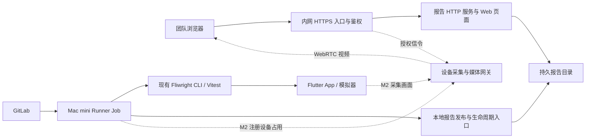

# 团队测试报告与运行观察设计

日期：2026-10-18。状态：报告交互参考；整体部署与队列职责已由后续提案调整，尚未批准实现。

用户新增平台测试队列、报告上传和分享需求后，推荐总体方案见[团队云测管理平台设计](./2026-10-18-team-cloud-platform-design.md)。本篇关于 GitLab 持有测试队列、独立 reports package、无数据库和共享口令的选择属于早期报告服务提案，不再是当前推荐；页面与证据展示设计仍供参考。

本文给出推荐方案，不代表功能已经实现。用户已确认独立报告服务、Mac mini 部署、团队内网访问；实时视频是期望增强项。包名、前端选型、访问控制和阶段划分仍属于本次提案。

## 1. 目标与首版边界

在已有 GitLab Runner Mac mini 上部署独立报告服务。成员通过一个固定内网地址浏览运行历史，通过单次运行链接查看结果、失败步骤和证据。GitLab 继续负责触发、排队、取消和执行，不新增任务调度平台。

推荐分两个里程碑：

| 里程碑 | 交付 | 完成标准 |
| --- | --- | --- |
| M1：团队报告 | 运行列表、CI 元数据、用例与执行尝试、时间线、失败信息、截图、日志、稳定链接 | CI workspace 删除后仍能完整查看；异常和不完整证据不被隐藏 |
| M2：实时观察 | 与具体执行及设备关联的浏览器实时视频，只读观看 | 真正模拟器画面端到端验证，任务切换不串流，观看负载可控 |

M1 的运行状态由 CI 侧生命周期同步，步骤与最终证据主要在产物发布后可见。M1 不承诺逐步骤实时同步。历史录屏回放、多租户、远程手动操作和测试调度不在这两个里程碑内。

## 2. 页面与使用路径

### 运行列表 `/runs`

- 列：项目、分支、提交、运行时间、执行状态、通过/失败/跳过数、耗时、证据状态。
- 筛选：项目、分支、状态、日期；搜索用例名称或运行标识。
- 链接：报告详情、GitLab Pipeline、GitLab Job。
- 无数据、发布失败、产物损坏、服务暂不可达有各自明确提示。
- 分页展示，默认最近 50 条；服务端过滤，避免浏览器拉取全部历史。

### 报告详情 `/runs/:executionId`

```text
项目 / 分支 / 提交 / Pipeline / Job
执行状态 | 测试结果 | 证据完整性 | 耗时

用例与执行尝试列表     步骤时间线             选中步骤的截图
  用例 A                准备场景               截图 / 错误详情
    attempt 1 失败        点击提交               断言 expected / actual
    attempt 2 通过        验证保存值             路由 / 源码位置
  用例 B

日志 | Trace | 执行级错误 | 产物下载
```

- 选择精确 `testId + attemptId`；失败尝试、最终通过、预期失败、flaky 信息分别展示。
- 时间线保留父子结构；展开步骤查看子动作、断言、错误和对应截图。
- 错误字段不存在时显示未采集，不从截图推断 expected/actual 或业务结论。
- 截图缺失只影响证据展示，不把原测试失败改成另一种结论。
- 详情链接可直接打开和刷新；不依赖当前浏览器之前的选择状态。
- 运行中显示阶段与最近心跳。结束后显示产物发布状态；无有效测试结果时不展示绿色通过。

### 实时观察 `/runs/:executionId/live`（M2）

- 显示项目、Job、设备、当前执行尝试、连接状态、最后画面时间与延迟信息。
- 仅该 execution 持有有效设备占用时允许开始观看；默认不自动播放。
- 支持开始/停止、静音观看、全屏；没有点击、键盘注入或接管入口。
- 结束显示“执行已结束”；采集失败显示“视频不可用”，报告仍可访问。
- 旧链接不得自动连接到下一任务。历史步骤截图与当前实时画面有明确区分。
- 隐藏标签页或停止观看后释放订阅。

## 3. 总体架构与部署



首期这些进程可共用一台 Mac mini；报告服务常驻，测试进程由 Runner 创建和销毁。报告服务不负责启动 Flutter，不向浏览器暴露 VM Service。

- 报告服务使用独立目录与最小权限账号，读取已发布产物。
- 本地发布工具拥有写权限；HTTP 端没有公开上传或执行任意命令的入口。
- `launchd` 管理报告服务；涉及窗口采集的 helper 运行在具备图形会话及采集权限的用户环境，不能假定后台 daemon 具备这些权限。
- Runner 和未来采集 helper 使用同一个受控的设备槽位身份，首期一个槽位。
- 数据目录位于 CI workspace 外；系统重启后可重建报告索引。
- 内网 DNS/固定地址经反向代理提供 HTTPS。报告 HTTP 进程默认只绑定 loopback。

M2 的媒体端口、ICE 可达性和是否需要 TURN 必须在实际团队网络验证；仅代理信令 HTTP 不等于 WebRTC 视频一定可达。

## 4. 模块与技术建议

建议新增私有 package `@fliwright/reports`，职责包括报告索引、产物读取、浏览器页面及本地 CI 发布命令。使用独立可执行入口启动服务或发布报告，不把这些职责放进 Core、Bridge 或 VS Code 包。

| 模块 | 职责 | 接口约束 |
| --- | --- | --- |
| Report catalog | 列表、过滤、分页、运行生命周期和发布状态 | 可从持久文件重建索引；不计算新的测试 verdict |
| Bundle reader | 读取 manifest、具体 attempt、Timeline、Trace 和日志 | 验证版本、身份、路径与内容类型；缺失证据返回诊断 |
| CI publisher | 注册执行、更新心跳与阶段、发布不可变产物、结束执行 | 执行身份、幂等、原子提交；错误不覆盖测试退出码 |
| Web viewer | 面向人的列表与详情 | 使用报告接口；不导入 VS Code 运行时代码 |
| Live session（M2） | 设备占用、短期观看授权与媒体状态 | execution/slot/设备代次绑定；过期即拒绝 |
| Capture helper（M2） | 模拟器画面采集与编码 | 不调用测试动作；不把整机桌面作为默认采集源 |

后端建议 TypeScript + Node HTTP；前端建议使用仓库已有 React 工具链，复用已有查看器的交互概念。源码可共享的部分必须先提取为环境无关模块，不能跨包导入 VS Code 私有文件。

M1 推荐持久文件加内存索引，暂不增加数据库。索引从 `execution.json` 和 bundle 重建，以更新通知加周期扫描对账。达到实际规模瓶颈后再评估 SQLite/外部存储，不预先引入分布式基础设施。

确切依赖、包边界和公共接口在方案确认后的实施计划中登记到 Harness；本次不修改依赖或架构规则。

## 5. 数据契约与真实状态

### 身份与元数据

- `executionId`：报告服务分配或发布工具生成的唯一执行标识，开始时即确定，与页面链接绑定。
- CI 身份：GitLab 实例、project ID、pipeline ID、job ID。重新运行 Job 为独立执行，不覆盖旧报告。
- App 身份：commit SHA、分支、target/build profile、平台和系统版本。
- 执行环境：workerId、slotId、设备 ID、工具链版本。
- 引擎身份：一个 execution 可关联多个 `runId`；用例仍使用现有 `testId/attemptId`。
- 时间：UTC 存储 started/finished/lastHeartbeatAt；页面按用户时区展示。

项目和提交信息由 CI 添加，不能假定当前 `run.json` 已有。页面 URL 使用 opaque executionId，文件系统路径由服务端映射。

### 三类状态分别展示

| 维度 | 示例 | 来源 |
| --- | --- | --- |
| 执行生命周期 | registered / preparing / running / finished / cancelled / lost | CI 包装流程及心跳 |
| 测试结果 | running / passed / failed / skipped / interrupted / unknown | 已验证的现有运行结果；没有结果则 unknown |
| 证据发布 | pending / publishing / available / partial / publish_failed / expired | 发布流程与读取校验 |

阶段耗时由包装流程记录。用例耗时、步骤耗时从实际结果和时间线读取；缺字段显示未知，不能把缺失或未执行解释为零耗时/通过。

心跳过期只能标记 lost/stale，不能断言业务测试失败或宣布设备已经安全释放。GitLab Job 状态对账可以补全取消/终止信息，凭据由执行机预置。

## 6. CI 接入与产物发布

1. Job 获取主机级设备槽位，生成 executionId，记录 CI/App/设备元数据。
2. 本地发布入口写入 registered，后续更新 preparing、running 与心跳。排队阶段仍由 GitLab 展示。
3. 执行现有 Fliwright CLI，独立保留其退出码和每个 runId。
4. `after_script`/包装脚本尽力导出 portable bundle；失败和中断允许显式 partial 导出。JUnit 和 GitLab artifacts 继续上传作为另一条保留路径。
5. 在报告数据盘的 staging 目录校验文件、manifest、校验和、引用完整性与脱敏策略。
6. 同一文件系统中原子 rename 发布到 bundles；最后原子更新 execution 的索引记录。
7. 更新生命周期与发布状态，停止该执行的心跳和观看授权，清理本次设备占用。

同一发布请求与内容重复提交应幂等；同一身份但内容不同必须拒绝覆盖并记录发布冲突。完成 bundle 不再修改，修复或追加采用新版本。

强制 SIGKILL、机器掉电时无法保证 `after_script` 执行；服务根据心跳和 GitLab 对账标识失联，不生成虚假的最终报告。进程恢复后清理 staging，并可重试尚未发布的导出。没有有效 manifest 时保留 execution 级失败记录和允许的 Job 日志链接，不伪造 bundle。

推荐目录结构：

```text
report-data/
  executions/<executionId>/execution.json
  bundles/<bundleId>/run.json、report.json、tests/…
  staging/<publicationId>/…
```

原始结果、证据和 CI 元数据分层存储；无需为了网页修改现有 Core 产物格式。

## 7. 视频方案与验证门槛

推荐最终使用 WebRTC 实时观看，原因是它支持浏览器低延迟解码、码率适配和连接状态反馈。它是设计选择，尚未完成 Mac mini 实测，也没有确定媒体库或网关产品。

| 方案 | 适合场景 | 取舍 |
| --- | --- | --- |
| MJPEG | 内网采集与浏览器链路的早期验证 | 接入简单；带宽和编码效率较差，不作为默认长期方案 |
| WebRTC | 正式实时观察 | 低延迟与码率适配；需要采集编码、信令、ICE 和连接运维 |
| HLS | 允许较大延迟的直播/回放 | 更容易分发；不优先用于本次实时观察 |

采集优先级：指定模拟器内容的专用采集接口；若不满足，再验证 macOS 指定窗口采集。iOS 与 Android 分别验证，不能因都显示在 Mac 桌面上就共用支持结论。窗口采集不得默认退化为整屏采集。

M2 必须先完成一项小规模技术验证：在实际 Mac mini 上，以真实测试任务同时运行采集、编码、浏览器播放，测量延迟、CPU、内存、带宽与用例耗时差异。建议先评估 720p / 10–15 fps、一个画面源、最多三个观看者、目标内网延迟 1 秒以内；这些是待验证目标，不能作为已具备的指标。

一个设备使用一个共享采集源，不能每个观看者重新采集。采集崩溃只影响观看；背压或过载应降低帧率或拒绝新增观看，保留测试执行资源。

设备占用生成 generation/fencing token，与 executionId、slotId、deviceId 绑定。每次观看由报告服务签发短期、只读授权；重连也要校验。任务结束、失联或设备切换即撤销旧会话并显示明确状态。实时授权和媒体地址不能复用为下一任务入口。

若技术验证未通过，仍可独立交付 M1，页面明确没有实时视频。定时更新测试截图不能命名为实时视频。历史录屏回放如需加入，应另外定义文件格式、存储预算、时间轴关联与保留策略。

## 8. 访问、数据与运维

- 首版面向单团队，建议 HTTPS + 团队共享访问口令；所有页面、接口、截图、下载和视频授权均受保护。账号与精细权限后续按团队要求扩展。
- 任意路径读取、目录遍历、跨 bundle/attempt 符号链接和主动内容执行必须被阻止。产物文本按文本渲染，截图限制格式和大小。
- 不记录完整 VM Service URL、测试凭据和观看令牌；项目日志/截图/Widget 树可能含敏感内容，发布前按项目策略处理。公共共享盘不能代替授权下载。
- 历史 bundle 默认保留 30 天，沿用现有产品决策；当前运行、待完成发布和用户正在下载的产物需明确清理保护策略。
- 配置数据盘容量上限、低空间阈值、清理记录和备份。磁盘不足导致 publish_failed，不更改原测试结果；同时 Job 需可观察到发布失败。
- 提供服务健康、磁盘可用量、索引对账、发布失败、活跃观看数和采集错误指标。禁止把任务传入的字符串作为任意 shell 命令执行。

共享口令、30 天保留和视频性能目标属于推荐默认值，评审后可调整。公网访问、GitLab OAuth/SSO、多团队隔离不自动包含在内网部署范围内。

## 9. 验收条件

| 场景 | 验收结果 |
| --- | --- |
| 正常通过、业务断言失败、runner 失败、取消 | 页面准确展示各自结论和错误，不靠退出码单独推断通过 |
| retry / expected failure / flaky | 所有尝试可切换，原始失败与最终结果同时保留 |
| 丢截图、损坏 JSON、缺 Timeline | 明确显示证据问题，页面其余信息仍可用 |
| workspace 删除、服务或机器重启 | 已发布历史报告可继续通过原链接访问 |
| 发布时断电、重复提交、内容冲突 | 不可见半成品；可恢复对账；不静默覆盖历史 |
| 强杀 Job / Runner 失联 | 心跳失效后显示 lost/stale，无伪造 passed，设备需重新验证后复用 |
| 未授权访问、路径逃逸、恶意文本 | 页面和资源均被保护；无文件越权或脚本执行 |
| 保留期与磁盘不足 | 有清理/过期提示；发布失败与测试失败分开展示 |
| 真机型模拟器实时画面（M2） | 实际 iOS/Android 配置分别验证，不以模拟源替代验收 |
| 视频任务切换、断连与重连（M2） | 不串任务、不残留旧流，停止后释放观看资源 |
| 并发观看与性能（M2） | 按约定设备和码率测量真实开销，再确定可承诺指标 |

## 10. 实施前评审点

推荐评审采用 M1 报告优先、M2 视频后续的范围，以及新增独立 reports package 的职责。视频协议、采集 helper 与媒体组件仅在技术验证后锁定。此文档完成后仍停留在设计阶段，用户确认开始实现后才修改产品代码、测试、依赖与 Harness。

## 11. 当前实现依据

- [Core RunContracts](../../../packages/fliwright-core/src/RunContracts.ts)：现有运行状态、证据状态、manifest 与具体 attempt 引用。
- [Core RunSession](../../../packages/fliwright-core/src/RunSession.ts)：测试身份、尝试结果、expected failure、flaky、operations 和 evidence。
- [Timeline types](../../../packages/fliwright-core/src/timeline/types.ts)：层级步骤、状态、时间、截图与错误引用。
- [CLI portable export](../../../packages/fliwright-cli/src/commands/artifacts.ts)：现有导出、partial 标记、引用校验与路径重写。
- [VS Code viewer](../../../packages/fliwright-vscode/src/viewer/ViewerPanel.ts)：现有交互可参考，但依赖 VS Code 宿主，不能直接部署为网站。
- [ADR 0002](../../adr/0002-start-cloud-platform-with-a-single-tenant-team-queue.md)：首期团队自托管定位；本方案先复用 GitLab 执行管理。
- [ADR 0007](../../adr/0007-retain-immutable-run-bundles-for-thirty-days.md)：不可变产物与默认保留期。
