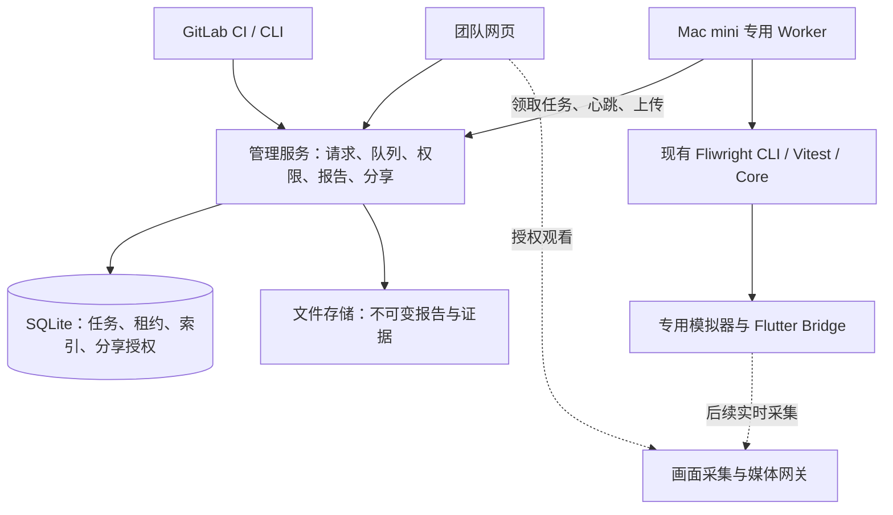

# Mac mini 团队云测管理平台设计

日期：2026-10-18。状态：用户后续已授权按计划实现；实施验收见[计划](../plans/2026-10-18-team-cloud-platform.md)。

本方案按用户新增的队列、报告上传与分享需求，将独立报告服务扩展为团队云测管理平台。它取代报告设计中“GitLab 持有唯一测试队列”的推荐，报告详情和实时观察的交互仍参考[报告设计](./2026-10-18-browser-reports-design.md)。

## 1. 产品定位

在已有 GitLab Runner 的 Mac mini 上常驻部署一套团队内部平台。平台管理测试请求、队列、执行、报告和分享；GitLab 负责代码托管及现有 CI，并作为平台客户端提交测试。团队成员也可直接通过网页提交测试。

第一版面向可信团队代码、注册的 Flutter 应用、固定 commit SHA、确定性脚本和预置模拟器。自然语言生成测试、任意上传源码或 Release 包、多租户 SaaS、远程手动接管不在首版范围。

## 2. 部署架构

管理服务和 Worker 首期部署在同一台 Mac mini，分开进程。后续可以把管理服务迁到服务器，或注册更多 Worker，无需改变测试引擎。

- 管理服务只管理任务与数据，不直接启动 Flutter。
- Worker 主动领取任务，持有构建、启动、测试、取消、设备重置能力。
- 管理服务使用 SQLite 事务持久化队列；数据库放本机磁盘，不放网络共享盘。产物与数据库分开存储。
- 产物首期存本地持久数据盘，未来需要远程扩容时再增加对象存储。
- 使用 `launchd` 管理进程；模拟器和采集进程的用户会话、权限另行验证。
- 浏览器经内网 HTTPS 入口访问；VM Service 仅在 Worker 内使用。
- 同机部署存在共同故障点，不承诺高可用；备份包含数据库、配置与已提交产物，并验证恢复。

## 3. 与 GitLab Runner 的分工

| 工作 | 负责方 |
| --- | --- |
| 源码仓库、MR、构建及其他 CI 工作 | GitLab 与现有 Runner |
| 提交 E2E 请求、等待结果、显示报告链接 | GitLab CI 中的平台客户端 |
| 测试排队、任务状态、取消与权限 | 云测管理服务 |
| 拉取固定提交、构建测试入口、模拟器与执行 | 专用 Worker |
| 报告上传、历史存储、网页浏览与分享 | 云测管理服务 |

首版采用“Worker 自行拉取源码并构建”的单一路径。复用 CI 预构建产物属于后续优化，需要另行验证测试 build、Bridge 和调试启动的兼容性。

CI 提交时传 target、commit、suite、scenario 和 CI 来源，不传任意命令、仓库凭据或 VM URL。Pipeline 可同步等待，也可只提交并返回链接。等待超时/客户端断开不会默认取消平台任务，取消必须显式请求。

若同一机器上 GitLab Runner 仍执行其他设备测试，需要独立设备或统一主机级占用管理。平台队列无法自动约束绕过平台的脚本。首期将云测模拟器专门分配给 Worker，并限制普通构建并发。

## 4. 网页功能

| 页面 | 首版功能 |
| --- | --- |
| 总览 | 排队/运行/完成数量、Worker 状态、近期失败、磁盘和发布异常 |
| 测试队列 | 提交、查看排队位置、取消、运行阶段；FIFO，暂不做动态优先级 |
| 新建测试 | 选择注册应用、提交、套件、场景和平台配置；服务端校验权限与兼容性 |
| 执行详情 | 元数据、阶段、日志、每次执行尝试、结果、取消状态与报告链接 |
| 报告 | 用例、重试、步骤时间线、失败断言、截图、Trace 与日志 |
| 报告分享 | 生成授权链接、有效期、允许内容、撤销；首版仅内网可访问 |
| Worker / 应用配置 | 健康、能力、槽位、暂停/恢复；注册应用与固定执行配置 |

请求开始时即分配稳定链接。运行中先展示阶段和日志；报告提交后显示可复核证据。第一版不承诺逐步骤实时推送；浏览器可通过 SSE 获取阶段/日志变化，断线按事件序号补读，服务端事件为状态的辅助展示而非唯一真相。

报告详情采用 Playwright 风格的执行时间轴：同一尝试的操作按真实开始时间定位，条宽表示耗时，父子及并行操作分轨排列，不累加嵌套耗时。点击时间条联动步骤、截图和证据详情；拖动时间游标按实际经过时间定位，支持缩放与横向滚动。缺失开始时间的步骤保留在列表，结束时间未采集时显示未完成标记，不能伪造耗时。团队报告与只读分享复用该组件，分享的安全时间线保留 `startedAt`/`endedAt`。实现读取 Fliwright Timeline，不依赖 Playwright 运行时。

## 5. 身份、状态与队列规则

沿用现有领域术语：ApplicationTarget、TestRequest、ExecutionAttempt、ExecutionWorker、ExecutionSlot、RunBundle。

- TestRequest：一次提交，包含来源、提交人、固定 commit、套件、场景、目标配置快照和幂等键。
- ExecutionAttempt：一次占用槽位的执行，独立保存基础设施错误、runId 和产物；不得与测试框架内部 retry 的 attempt 混淆。
- ExecutionSlot：Worker 与指定设备的独占资源；首期一台 Worker、一个槽位。
- RunBundle：关联 request/attempt/run/test/attempt 身份的不可变证据包，保留现有引擎格式。

请求状态：queued → assigned → preparing → running → finalizing → completed；另有 cancel_requested / cancelled / infrastructure_failed。`completed` 不代表测试通过。测试 verdict、证据发布状态和 Worker 清理结果分别记录。

事务内选择最早可运行任务并声明槽位，生成租约 generation 与期限。Worker 心跳带任务、槽位、generation；上传与状态写入均校验所有权。重复提交采用幂等键，内容冲突拒绝。

租约过期后先标记 Worker unhealthy 和任务失联，撤销旧 generation。**过期不代表设备已空闲**：旧执行需被确认终止，设备完成 reset 后才能再次分配。过期 Worker 的写回被拒绝；网络分区时 Worker 应主动停止其任务并隔离设备。首期同机恢复可由本机 supervisor 核验进程组和设备。

基础设施瞬态故障最多新增一次自动 ExecutionAttempt。断言/业务失败不自动重跑，避免以重试掩盖问题；人工重跑生成可追踪的新请求。构建配置错误、重置失败等不能一律认定瞬态。

排队取消直接终结；执行中取消先记录请求，由 Worker 停止所属进程、尽力提交 partial 证据并 reset。清理超时则隔离槽位，不能提前宣称已释放。服务重启从数据库和 Worker 状态对账，不能仅因进程重启就重派仍在执行的任务。

## 6. Worker 的完整执行周期

领取任务 → 校验配置/资源 → 独立工作目录 checkout 固定提交 → 安装/构建 → reset_before → 启动模拟器与测试 App → 严格 Endpoint/Bridge 能力预检 → 应用 Scenario 并执行 → 导出产物 → 上传并提交报告 → reset_after → 释放槽位。

每阶段记录时间与错误。认证业务测试使用应用自有 `auth.seedLoggedIn`，不运行真实登录或验证码绕过。Scenario 的应用状态准备不能代替操作系统、设备与所需后端数据重置。

凭据由 Worker 预置；注册 target 控制允许的仓库、入口、套件和构建配置，但仓库代码及构建本身仍有代码执行权限。因此首版仅允许授权团队代码，Worker 账户与凭据访问须限定范围。

上传异常和清理异常独立记录，不覆盖原始测试 verdict。上传可在本地持久 spool 保留后重试；报告尚未发布时页面显示 publishing/publish_failed，不伪造可用报告。首版可先在 finalizing 阶段上传后释放槽位，后续再优化为异步上传。

## 7. 报告上传、分享与保留

报告上传采用独立 publication 身份，支持分文件重试：创建上传 → staging 写入 → 校验文件清单/大小/摘要/路径/引用/身份 → 原子提交 bundle → 事务提交索引。

文件提交和 SQLite 不构成单一事务，采用可重入提交和定期对账：已提交但未索引的 bundle 可恢复；未提交 staging 不可浏览；同 publication 重试幂等，冲突不得覆盖。上传凭据仅授权当前执行，限制容量并处理磁盘不足。拒绝目录穿越、符号链接越界和主动脚本内容。

报告链接分两种：

- 团队链接：成员登录后访问完整授权报告。
- 分享链接：限定单个报告版本、只读、短期、可撤销；令牌保存摘要，兑换短期会话后跳转干净 URL，原始令牌不写访问日志。默认不开放日志/网络响应等敏感详情，需显式选择范围。

分享不改变网络可达性，内网链接不会自动成为公网链接。未经单独设计不开放匿名公网报告或视频。默认最多七天且不超过报告保留期，链接失效显示过期/撤销，不跳到其他报告。实时画面不继承报告分享权限。

历史产物默认保留 30 天。删除后保留轻量 expired 记录便于解释旧链接；明确下载中的保护、磁盘阈值、清理审计和备份策略。GitLab artifacts 可继续作为独立保留路径，但不代替本平台发布状态。

## 8. 权限与配置

使用 member / operator / admin 角色：成员提交和查看团队结果；运维管理 Worker 与人工重跑；管理员管理 target、凭据策略、保留和成员。正式首版不采用共享口令代替可归属的任务管理；认证建议复用 GitLab OAuth，或受信反向代理身份，具体选型评审时确定。

浏览器身份、CI 服务令牌、Worker 注册凭据和报告分享令牌分开。所有路径实施服务端授权，修改操作具有 CSRF 防护或明确 bearer-token 机制。秘密值不进入日志和产物索引。

实现选型已登记 Harness：私有 cloud 包使用 Fastify、React/Vite 与 Node 26 内置 SQLite。SQL migration 明确版本化；不引入 ORM 或原生数据库驱动。浏览器身份采用受信反向代理，CI 与 Worker 使用独立 bearer 凭据。

## 9. 包与发布建议

建议一个私有 `@fliwright/cloud` package，包含两个独立可执行入口：`server` 与 `worker`；内部划分队列、Worker 执行、报告、分享和网页模块。先统一开发发布，待需要时再拆包。

报告模块按[报告设计](./2026-10-18-browser-reports-design.md)复用现有 manifest/Timeline/Trace，替代另建独立 reports package 的建议。Core 只保留引擎职责，不吸收队列、账户、数据库或网页。媒体网关按后续采集方案独立部署，不强行放入 Node 测试进程。

## 10. 分期与验收

| 阶段 | 交付 | 验收重点 |
| --- | --- | --- |
| P1：管理闭环 | 单团队登录、注册 target、网页/CI 提交、SQLite FIFO、单槽位 Worker、取消、报告上传浏览、团队稳定链接 | 同一任务不并行重复执行；服务重启不丢队列；正反例结论正确；workspace 删除后仍可查 |
| P2：团队运营 | 分享授权、上传恢复、保留清理、审计、Worker 管理、GitLab 门禁集成 | 上传中断可重试；分享可撤销；失联不错误释放设备；磁盘满仍保留原 verdict |
| P3：实时观察 | 任务/设备绑定的只读视频 | 真模拟器采集、任务切换不串流、断连回收、观看开销实测 |

从 P1 开始就必须具备设备 reset、租约代次、幂等和基础故障收敛，不能留到运营阶段补。视频遵循报告设计中的技术验证门槛；WebRTC 为候选推荐，未验证采集链路前不承诺帧率与延迟。

首个交付切片为：网页或 GitLab 提交固定提交的测试 → 单槽位排队执行 → 页面查看原始结果与证据 → 取消/失联后设备正确清理。通过后再拓展分享体验和视频。

## 11. 设计依据与待评审项

本方案与现有 [ADR 0002](../../adr/0002-start-cloud-platform-with-a-single-tenant-team-queue.md)、[ADR 0003](../../adr/0003-run-queued-e2e-work-on-team-operated-workers.md)、[ADR 0004](../../adr/0004-restrict-queued-work-to-registered-application-targets.md) 以及 [CONTEXT](../../../CONTEXT.md) 的团队自托管、注册 target 与 Worker 模型一致。用户后续授权实现网页管理入口，ADR 0002 已同步此交付顺序。

P1/P2 通过独立 cloud package 交付；平台持有唯一测试队列，server/Worker 分进程，SQLite 与本地产物持久化。代码与本机真实模拟器验收见[实施记录](../plans/2026-10-18-team-cloud-platform.md)。正式 Mac mini 的域名、身份代理、凭据与设备映射由部署时配置；P3 视频采集和传输保持独立技术验证范围。
