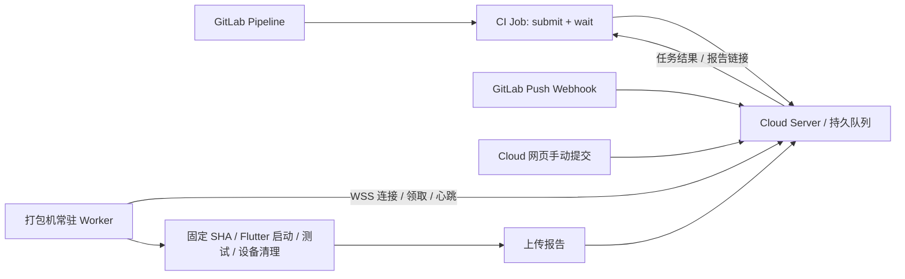

# GitLab 触发打包机 Cloud 任务设计

日期：2026-10-21。状态：建议方案，待部署验收；本文不修改 CI 或常驻服务。

## 1. 决策

当前选择：Cloud Server 部署到公网，GitLab Push Webhook 触发云测，打包机部署内网常驻 Worker。CI 文件由多个环境共用，首期不改 CI 配置。测试结果先在 Cloud 查看；需要影响 GitLab Pipeline 成败时，再单独接入 CI `submit → wait`。两种入口共享 Cloud 队列与 Worker，执行调度权归 Cloud。

打包机部署常驻 Cloud Worker，由 Worker 主动连接 Server 领取任务。CI Runner 可以在打包机，也可以在能访问 Server 的其它机器；提交客户端只需要 Node 和已构建的私有 Cloud 客户端，无须 Flutter、Xcode 或设备。

本方案的“Cloud 任务”指当前 Fliwright 云测。IPA/APK 发布打包继续使用现有 GitLab 构建 Job；若要将发布打包也迁入 Cloud，需要另行设计构建任务、签名凭据和产物模型。

## 2. 触发策略

| 场景 | 入口 | 是否等待结果 |
| --- | --- | --- |
| MR 或默认分支的测试门禁 | GitLab CI | 是，Job 状态跟随 Cloud 结果 |
| GitLab 页面手动运行指定套件 | `when: manual` CI Job | 是 |
| 默认分支推送后持续观察质量 | Push Webhook | 否，到 Cloud 查看结果 |
| 临时调试或精确单用例 | Cloud 项目页 | 否，在 Cloud 跟踪 |

首期接默认分支 Push Webhook，完成真实链路验收。当前 Webhook 入口仅支持配置分支的 Push Hook，不会自动形成 MR/Pipeline 门禁。后续接入 CI 时，`rules` 明确允许的 pipeline 来源，避免一次 push 同时产生重复的 branch/MR 门禁。

同一分支、suite/scenario 首期只启用一种自动触发方式。Webhook 当前不会与 CI 提交自动合并；同时启用会创建两次执行。需要两种策略时，明确分配不同测试组合。

## 3. CI 执行契约

1. CI 使用 Cloud 注册项目的 ID，提交完整 `CI_COMMIT_SHA`、suite、scenario、branch、Pipeline URL 和 Job URL；仓库、命令、设备和凭据由 Cloud/Worker 配置决定。
2. `submit` 快速入队并返回 request ID 和稳定 URL，CI 立即打印 URL，并保存 `cloud-submitted.json`。
3. `wait` 轮询该 request，排队期间保持 Job 等待，不由 Runner 直接操作设备。
4. 成功条件为 `completed + passed + clean + 最新 attempt 报告 published`。测试失败、基础设施失败、取消或清理/报告不满足门禁条件均不能放行。
5. 当前客户端成功退出 0，终态门禁失败退出 1，等待超时退出 2。`cloud-result.json` 保存已返回的终态；超时或网络失败可能没有结果 JSON，诊断仍可使用已保存的 request ID 和 URL。

沿用现有入口和模板：

- [GitLab CI 模板](../../../packages/fliwright-cloud/deploy/gitlab-ci.example.yml)。
- [客户端配置](../../../packages/fliwright-cloud/deploy/client.example.json)。
- 命令：`node "$CLOUD_CLIENT" submit "$CLOUD_CLIENT_CONFIG" cloud-request.json "$REQUEST_KEY"`，随后 `node "$CLOUD_CLIENT" wait "$CLOUD_CLIENT_CONFIG" "$REQUEST_ID"`。

当前 `submit` 请求字段仍为 `targetId`，其值使用 Cloud 已注册的项目 ID；不能直接改成 GitLab 数字项目 ID，也不能只把字段改名为 `projectId`。项目页 Catalog 提交与现有 CI suite 提交的 API 契约目前不同。

### 幂等与重跑

建议单个 CI Job 的请求键包含 GitLab project ID、pipeline ID、job ID、suite 和 scenario，总长度不超过 200 字符。同一 Job 内的网络重试复用相同键与完全相同请求内容；GitLab Retry 产生新 job ID，视为一次显式重跑。

现有示例使用 pipeline ID 和 suite 作为键，却在内容中保存 Job URL。GitLab Retry 后 Job URL 变化可能触发 409；接入时需同步调整示例，并将 scenario 纳入键。幂等保证请求不会因提交重试而重复入队，不保证设备进程在任意故障下只执行一次。

### 超时与取消

首期沿用现有语义：CI 超时、网络断开或用户取消 Job，不自动取消 Cloud 请求。用户可在 Cloud 取消，或使用该 CI 身份调用 `cancel`；已运行任务按 Worker 停进程、导出证据、重置设备的流程结束。

CI Job 超时必须大于客户端等待上限，并预留提交和收集结果的时间。不要只在 `after_script` 中无条件取消任务；它也会在正常结束时执行，且不能保证所有强制终止情况下都会执行。

后续若要求“取消 Pipeline 同时取消云测”，增加明确的可选联动策略及可靠的取消协调，再验收排队、运行中、Runner 失联与重复取消场景。

## 4. 打包机与构建的分工

### 公网 Server 与内网 Worker 连接

Worker 使用 `serverUrl: https://cloud.example.com`，主动建立 `wss://cloud.example.com/api/worker/connect` 长连接。空闲时等待队列变化通知再领取任务，扫描也按通知领取，不使用定时 HTTP 轮询；执行心跳、设备清单、扫描结果和取消通知复用控制连接。Server 每 10 秒 ping 保活，执行期间默认每 5 秒发送租约心跳并携带执行阶段与日志片段。报告文件及发布流程继续通过 HTTPS 上传。打包机不需要公网地址、入站端口映射或反向隧道，但必须能访问 Cloud、Git 仓库和安装依赖所需服务。

每台主机使用独立 Worker 身份和 Bearer token：Server 登记 `workerId` 与 token 的 SHA-256，打包机通过 `tokenEnv` 指定的环境变量读取 token 原文。Server 的 Worker 登记和槽位、网页设备纳管与授权、本机 `workerId/slotId/deviceId` 必须匹配。公网反向代理需允许 Bearer 请求由 Cloud 校验，而非跳转浏览器登录页。

空闲连接断开后指数退避重连；鉴权拒绝不重连。未完成请求不会自动重放；执行中失联立即中止并保留本地槽位锁，服务端租约过期隔离设备。恢复网络后仍需显式 `recover` 核验清理再恢复调度，不自动接着跑中断的测试。扫描断线同样中止，按扫描租约过期处理。

首期保留 Worker 自行检出固定 SHA、安装依赖并通过 Flutter 启动测试应用的路径。CI 可将云测 Job 放在静态检查之后；只有存在真实依赖时才等待发布打包 Job。上游打包成功并不代表 Cloud 当前会复用其 IPA/APK。

打包机部署要求：

- Cloud Server 可独立部署，也可首期同机；Worker 通过 WSS 主动连接并按通知领取任务，无须为 Worker 开放入站控制端口。
- 每个执行槽位有独立 Worker 配置、root 和专用设备；iOS Worker 在可使用 Simulator 的 macOS 登录会话中由 launchd 常驻。
- 网页纳管设备后仍需部署槽位执行进程；仅设备扫描进程不能运行测试。
- Worker 保存只读仓库凭据；GitLab CI 保存独立 Cloud CI token。客户端凭据不传给测试脚本。
- 若原 GitLab Runner 也在同机打包，限制构建并发并预留 Flutter/Xcode 资源。GitLab `resource_group` 只能串行相关 GitLab Job，不能约束 Cloud 网页任务或 Worker；设备独占由 Cloud 槽位租约保证。

若未来复用 CI 构建产物，新增不可变产物引用、SHA/摘要校验、访问权限和 Bridge/调试启动兼容性验证，再替换 Worker 源码构建路径。

## 5. 现状与待补项

当前工作区源码已包含 CI 的 submit/wait/cancel、Bearer 认证、队列、Worker 执行、报告门禁和 Push Webhook 扫描后自动入队。这说明基础链路已有代码，不代表目标 GitLab 和打包机已完成部署。

当前 Webhook 部署的首期落地工作：公网 HTTPS Server、项目设置中的自动策略和 Webhook secret、GitLab 项目 Webhook、内网 Worker 与专用设备。入口代理需放行 Webhook 到应用鉴权。无需改共享 CI 文件。

后续 CI 门禁接入工作：

1. 在 Cloud 注册实际仓库、suite/scenario、安装步骤；部署只读仓库凭据、Worker 和专用设备，先完成网页手动测试。
2. 在可访问 Cloud Server 的 Runner 预装已构建的私有客户端；当前不是可直接从公共 npm 安装的发布产品。
3. 配置 GitLab CI 变量、客户端配置和服务端 token 摘要。CI token 的可用范围要匹配所运行的分支；仅设置 Protected 变量会影响非保护分支/MR 的接入。
4. 调整模板的 Runner tag、客户端路径、实际项目 ID、幂等键、Job 超时与 rules，保存请求和结果 artifacts，使用 `allow_failure: false` 作为必需门禁。
5. 验证 HTTPS 入口允许 CI Bearer 请求直达服务端校验，不被 OIDC 登录页重定向。

需要补齐或明确的产品边界：

- 来源目前只有 `manual/push`，现有 CI 请求会被记为 manual；后续加入服务端派生的 `ci` 来源，保留 GitLab project/pipeline/job 身份。
- 当前 CI token 可提交已注册目标，没有项目级 token allowlist；接入多团队或不受信 MR 前增加项目和测试组合授权，不能把现有 token 描述为已按项目隔离。
- CI suite 路径当前不要求 Catalog；若统一到项目 Catalog 模型，需要显式设计 CI 扫描、固定 config revision 和等待状态，再迁移客户端。
- nginx 模板已提供 WebSocket Upgrade 与 Webhook 独立鉴权入口；部署时核对 TLS、Authorization 转发和浏览器身份头清除。

## 6. 部署验收

以真实 GitLab Pipeline 验证：固定 SHA 与 Worker checkout 一致；测试成功放行；断言失败阻断；清理失败或报告未发布阻断；两个请求争用一个槽位时正常排队；同一提交重试不重复入队；GitLab Retry 可显式创建新执行；等待超时后仍能从稳定 URL 找到任务；取消后设备完成清理。Webhook 若启用，另验收 secret、重复 delivery、非目标分支和连续 push 的 supersede 行为。

本文对应的 WSS 控制通道已实现并通过本地网络集成测试，尚未执行公网、真实 GitLab 和打包机上的部署验收。
