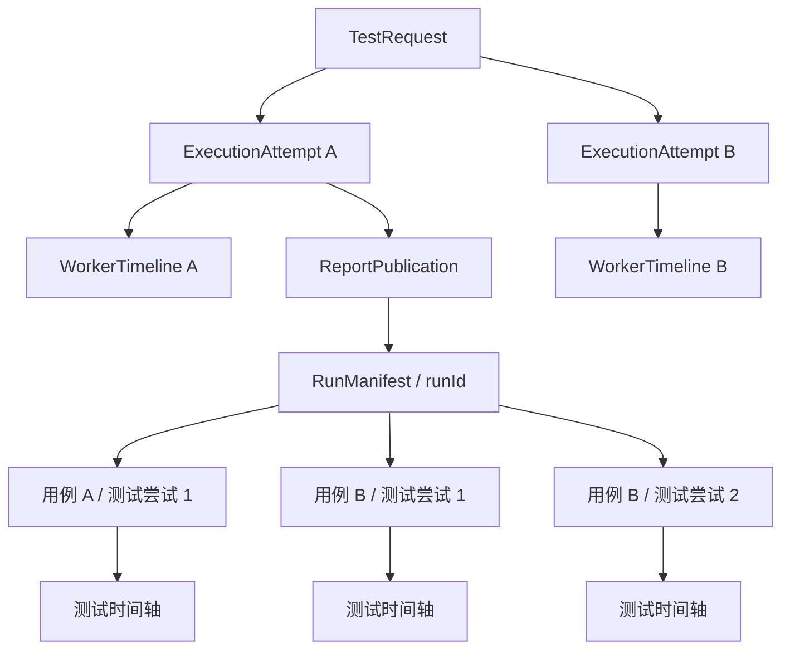

# Worker 独立执行时间轴设计

日期：2026-10-21。状态：首版已实现；真实 Flutter VM Service 端到端验收尚未执行。

本设计细化[团队云测平台设计](./2026-10-18-team-cloud-platform-design.md)中“每阶段记录时间与错误”的要求。用户已确认：Worker 执行过程单独记录，测试时间轴只包含测试过程中发生的事件。

## 1. 设计结论

新增独立的 **Worker 执行时间轴**，归属于 Cloud 的一次 `ExecutionAttempt`。现有测试时间轴仍归属于测试运行中的单个用例尝试。两者通过执行身份和测试报告关联。

- Worker 时间轴记录环境准备、App 启动、测试运行、报告发布和设备清理。
- 测试时间轴记录 Scenario、操作、断言、Mock、Agent 和测试证据。
- Worker 事件类型、记录器和持久化协议放在 Cloud 所属包；不扩展 Core 的 `TimelineNodeKind`。
- Worker 时间轴从领取任务后开始，无须等待测试报告产生。启动失败和无报告任务也能查看。
- 时间轴覆盖报告发布后的清理过程，独立存储于 Cloud；不追加写入已发布的测试 bundle。

首版优先记录真实、可验证的阶段边界。没有可靠观测信号时，不把 Flutter 的整段启动耗时猜分成编译、安装和启动耗时。

## 2. 当前实现与缺口

以下为本次设计时读取的工作区源码行为，包括工作区已有的未提交改动。

| 位置 | 当前行为 | 需要补齐 |
| --- | --- | --- |
| `cloud-worker/src/executor.ts` | 通过 IPC 上报 `checkout/install/reset_before/launch/running/export` 阶段字符串 | 显式开始、结束、结果、父子关系和错误归属 |
| `cloud-worker/src/WorkerAgent.ts` | 更新 `slot.lock`，用心跳上报当前阶段，监督执行并发布、清理 | 覆盖父子进程的统一记录器，以及监督阶段的独立事件 |
| `cloud/src/CloudStore.ts` | 用服务端接收时间保存阶段变化和日志 | Worker 采集时间、稳定事件身份、去重和时间轴读模型 |
| `cloud/src/web/app.tsx` | 任务详情显示运行动态；报告发布后自动跳转报告 | 跳转前后均可访问同一次执行的 Worker 时间轴 |
| `cloud/src/web/TimeTimeline.tsx` | 消费测试节点、截图与回放状态 | 新增独立 Worker 展示；只按实际复用价值抽取时间轴布局逻辑 |

现有阶段变化不能证明上一阶段成功，也无法区分测试失败、导出失败和清理失败。现有浏览器运行动态仅保留最近 500 条，不适合作为完整时间轴的数据源。

## 3. 归属和身份



`executionAttemptId` 在本文中专指 Cloud 槽位执行的 `LeaseKey.attemptId`；测试内部的 `attemptId` 始终通过 `runId/testId/testAttemptId` 完整路径标识。

- 每个 Cloud 执行尝试独立拥有时间轴、事件序号和终态。
- Cloud 自动重试产生另一条 Worker 时间轴；测试框架内部 retry 只产生新的测试尝试。
- `tests.run` span 可以关联一个 `runId`。用例和内部重试列表由该报告的 manifest 提供，不逐条复制到 Worker 时间轴。
- `bundleId` 由服务端根据已提交 publication 的执行归属关联；Worker 不能任意指定其他执行的报告。
- 排队耗时和领取任务前的请求取消属于请求生命周期，在任务页摘要展示，不伪造为 Worker 阶段。

## 4. 阶段模型

### 4.1 首版阶段

按真实调用边界记录，正常路径通常如下；失败、取消时允许跳过后续业务阶段并进入监督清理。

| phase | 展示名称 | 记录位置和结束条件 |
| --- | --- | --- |
| `execution.prepare` | 准备执行进程 | supervisor 创建任务目录、校验配置、启动 executor，至子进程握手成功 |
| `repository.checkout` | 获取测试代码 | clone、fetch、checkout 和固定 SHA 校验结束 |
| `dependencies.install` | 安装项目依赖 | 配置的 install 命令全部完成；无命令时不创建 span |
| `device.reset.before` | 准备测试设备 | 本次执行的前置 reset 命令完成 |
| `app.launch` | 启动 Flutter App | 本次启动请求开始，至 EndpointSource 返回该 App 的 VM 地址；包含 Flutter 启动及等待 debugPort |
| `app.verify` | 验证测试连接 | resolver 的 verify 回调实际完成 VM Service / Bridge 就绪检查 |
| `tests.run` | 运行测试 | `runCommand` 调用开始至返回测试运行结果或抛出错误 |
| `artifacts.export` | 导出测试报告 | 报告导出与源码证据收集结束 |
| `processes.stop` | 停止执行进程 | supervisor 停止并确认本次拥有的进程组；包含异常中止后的核验 |
| `report.publish` | 发布测试报告 | 创建 publication、上传及提交结束；没有 bundle 时不创建 span |
| `device.reset.after` | 清理测试设备 | 后置 reset 与其监督完成 |

已有 `assigned/preparing/running/finalizing/finished/lost` 仍是调度状态或其摘要。显式映射新的 phase 到原有请求状态，不能按字符串相等判断，否则发布、清理阶段会错误回退到 preparing。

`app.launch` 不是 App 整个存活期；进程存活可以与测试、导出重叠。executor 内部 dispose 与 supervisor 最终终止核验在各自真实位置记录，不为图形整齐而移动现有操作。

### 4.2 子操作和里程碑

span 可以通过 `parentSpanId` 包含子操作，首版支持：

- checkout 下的 clone、fetch、checkout 和 SHA 校验。
- dependencies/install、device/reset 下按配置顺序执行的命令。
- report/publish 下的准备与提交摘要；不默认对每个上传文件创建 span。

Flutter 的 `app.start`、`app.started`、`app.debugPort` 若被实际观测到，记录为 `app.process_started`、`app.started`、`vm.endpoint_observed` 里程碑。VM 地址本身不写入事件。

里程碑按观测顺序记录，不假设 debugPort 一定晚于 app.started。构建、安装子阶段须有可靠的结构化开始和结束信号后才扩展；首版不解析人类可读 stdout 猜测边界。

## 5. 独立事件契约

`@fliwright/cloud-protocol` 新增 `worker-timeline.ts`，通过 `src/index.ts` 导出严格 Zod schema 和类型。以下是设计形状，最终实现以这些约束为准。

```ts
type WorkerTimelinePayload =
  | {
      type: 'span.started';
      spanId: string;
      parentSpanId?: string;
      phase: WorkerPhase;
      operation?: WorkerOperation;
      commandIndex?: number;
    }
  | {
      type: 'span.finished';
      spanId: string;
      status: 'succeeded' | 'failed' | 'interrupted';
      reason?: WorkerStopReason;
      error?: { code: string; message: string };
      exitCode?: number;
      testVerdict?: Outcome['verdict'];
      runId?: string;
    }
  | {
      type: 'milestone';
      name: WorkerMilestone;
      spanId?: string;
    };

interface WorkerTimelineEvent {
  schemaVersion: 1;
  seq: number;
  recordedAt: string;
  offsetMs: number;
  payload: WorkerTimelinePayload;
}

interface WorkerTimelineBatch extends LeaseKey {
  originAt: string;
  events: WorkerTimelineEvent[];
}
```

身份由请求外层的完整 `LeaseKey` 提供；禁止事件内部覆盖 request、worker、slot 或 generation。事件唯一身份为 `(executionAttemptId, seq)`，spanId 在该执行内唯一。

`phase/operation/milestone/reason/error.code` 使用有限枚举；文案由页面映射。支持的停止原因包括取消、超时、主进程停止和 executor 异常退出。命令详情只记录用途、索引、耗时与退出码，不自动记录 argv、环境变量或凭据。

日志继续走现有的有界诊断通道，增加可选 `workerSpanId` 关联及其执行身份校验，不复制到结构事件中。日志时间和 span 的区间关联仅在没有显式归属时作为辅助筛选，界面标明“同期日志”。

### 5.1 事件约束

- `seq` 从 1 连续递增，`offsetMs` 非负且不递减。
- `originAt` 在同一执行内固定；服务端验证 recordedAt 与 originAt/offsetMs 一致，不能用新批次移动整条时间轴。
- span 必须先 started 后 finished，只能有一个终态；子 span 开始前父 span 已存在且未结束。正常关闭父 span 前，其已打开的子 span 必须先结束。
- 只支持预定义的 phase 和子操作组合，不开放任意层级的通用 trace 协议。
- 完整事件序列不可变；同序号同内容重传可接受，同序号不同内容返回冲突。
- 缺少 started 时拒绝 finished；进程崩溃留下的开放 span 由终态投影解释，不能伪造 finished 事件。

## 6. 记录器、时钟和本机持久化

新增 Worker 内部模块 `WorkerTimelineRecorder`，提供小接口 `startSpan`、`finishSpan`、`milestone`；网络批量发送和持久化由该模块内部管理。

**supervisor 是本次执行唯一的事件写入者和序号分配者。** executor 通过 IPC 发结构消息；supervisor 分配序号和时间，写入后 ACK。子进程等待 started ACK 后执行操作，结束消息 ACK 后再退出，避免“App 已开始启动，started 事件尚未持久化”的常规窗口。

- supervisor 创建记录器时捕获 UTC 壁钟和单调时钟起点。
- `offsetMs` 使用 supervisor 单调时钟，`recordedAt = originAt + offsetMs`；页面明确这是采集时间。
- 同一执行不混用服务端接收时间、子进程的 `performance.now()` 和 Worker 壁钟计算耗时。IPC 传递及 ACK 是采集边界的一部分，不声称是 Flutter 内部的精确耗时。
- 服务端另存 `receivedAt`；服务端租约结束时间单独展示，不能减去 Worker 时间计算阶段耗时。
- 事件先顺序写入 `<root>/spool/<executionAttemptId>/worker-timeline.jsonl`，再进入发送队列；结构事件执行持久化刷新。目录和文件沿用现有私有权限。
- 最后一行意外截断时仅恢复完整行，标记记录不完整。禁止把半条记录补成成功事件。
- IPC 记录 ACK 使用有限超时，记录器磁盘错误也必须有界失败。可观测性故障标记 `partial` 并继续原业务控制；不能让记录器挂死执行或覆盖测试 verdict。

建议批量上限 64 条 / 256 KiB，单条最多 4 KiB，错误摘要最多 1 KiB。事件数量、子操作数量和本机文件容量均设置明确上限；达到上限优先停止子操作明细并保留顶层阶段，标记 partial，禁止静默丢弃后仍显示 complete。

## 7. 上报、存储和实时更新

### 7.1 Worker 上报

在现有 WSS operation allowlist 中增加 `/api/worker/timeline`。它是控制连接上的操作名，不新增绕过 WSS 的公开 Worker HTTP 写入入口。

- Worker 显式批量发送记录器队列；心跳仍独立续租，不等待诊断积压。
- 心跳可附带 `timelineClock: { offsetMs, lastProducedSeq }` 单调时钟采样和记录质量告警，供运行中显示与完整性检查使用；采样不分配结构事件序号，也不替代丢失的事件。
- 服务端在事务中校验 `owned(LeaseKey)`、序列、span 状态、容量和输入约束，再保存并返回连续的 `ackSeq`。
- ACK 丢失后，**仅在原连接仍有效且租约仍持有时**，记录器可显式重发未确认批次；通用 `WorkerControlClient` 不自动重放 RPC。
- 非连续批次返回期望序号，Worker 从本机日志补发缺口；合法重复前缀先校验一致，再追加后缀。
- 传输中断或租约失效仍按当前实现停止任务并隔离槽位。重新连上不能恢复旧测试、续旧租约或回写其结果。
- 首版不增加过期租约的诊断导入接口。未上报的尾部保留在本机 spool，Cloud 显示 partial；未来如需补传必须另设纯证据导入契约，不能放宽 `owned()`。

任务完成前尝试有界 flush，再调用原有 finish。新记录器在 finish 附带 `lastProducedSeq`、Worker 结束偏移及记录质量告警；服务端据连续 ackSeq、是否仍有开放 span 和告警决定完整性。flush 失败不能阻止提交真实 outcome；它导致时间轴 partial，而不是拒绝真实 outcome。断线导致 finish 不可达时，仍走原有租约丢失流程。

### 7.2 Cloud 持久化

新增 `worker_timeline_events` 表，由 Cloud 的下一次数据库 migration 创建，不硬编码当前正在开发的版本号：

| 字段 | 用途 |
| --- | --- |
| `attempt_id` | 关联已有 ExecutionAttempt |
| `seq` | Worker 事件序号；与 attempt_id 组成主键 |
| `received_at` | 服务端接收时间 |
| `data` | 校验、脱敏后的事件 JSON |

事件去重须比较规范化输入与已有记录的一致性；脱敏策略必须稳定，不把原始敏感输入落库供后续比较。记录器负责在本机持久化前脱敏，服务端再按严格 schema 和相同允许字段校验。

在 attempt 的时间轴摘要中保存 `originAt`、`ackSeq`、`quality`、录制告警和 Worker 结束偏移。`quality` 使用 `recording/complete/partial/not_recorded`，与执行终态独立：完整记录一次失败执行仍可以是 complete。

现有 `attempt.stage` 保留为调度和列表摘要，不再作为新时间轴事实来源。旧的阶段变化、日志和请求审计仍可在运行动态查看；新时间轴不从旧日志倒推时长或补造事件。

### 7.3 读取与刷新

新增团队读取接口：

```text
GET /api/requests/:id/attempts/:executionAttemptId/worker-timeline
GET /api/requests/:id/attempts/:executionAttemptId/worker-timeline/events?after=0&limit=200
```

第一个返回完整的结构投影、revision、cursor、记录完整性和报告关联；第二个用于分页读取原始结构事件。访问时同时验证请求权限以及 executionAttemptId 确实属于该 request。

读模型固定区分 `executionStatus`、`testVerdict` 和 `quality`，分别回答“本次执行是否结束”“测试是否通过”和“记录是否完整”；span 投影包含原始事件 seq 范围，便于定位诊断。`cursor` 只表示连续接收的 Worker 结构事件序号，`revision` 同时覆盖服务端终态变化，两者不能互换。

每次批量提交在同一事务中追加一条轻量请求事件 `worker-timeline-updated`，只含执行 ID 与 revision。沿用现有 `/api/requests/:id/events` SSE 通知，浏览器收到后按执行 ID 刷新；重新连接时重新读取快照对账。不得用运行动态组件最近 500 条记录拼装时间轴。

finish、租约丢失也触发 revision 更新。终态投影由服务端现有 attempt 结果与请求事件共同决定；即使未收到任何 Worker 事件，也能显示“已分配，未收到执行记录”及服务器确认的最终状态。运行中的视图沿用任务页已有的 2 秒对账节奏读取最新时钟采样；终态停止周期刷新。

## 8. 状态、失败和耗时

span 运行时为 `running`，显式终态为 `succeeded/failed/interrupted`。服务端对失联时没有 finished 证据的 span 投影为 `unknown`。

| 场景 | 时间轴行为 | 结果语义 |
| --- | --- | --- |
| 编译或启动失败 | `app.launch` failed，保留错误摘要，后续测试阶段不创建，继续记录实际清理 | 沿用基础设施失败分类，无测试报告也可查看 |
| 某个用例断言失败 | `tests.run` succeeded，并标记 `testVerdict: failed`；链接失败用例 | 表示 runner 完成；任务测试结果仍为 failed |
| runner 异常 | `tests.run` failed，若取得 partial 结果则保持其 runId 关联 | 不伪造测试通过；保留已观察的测试结果 |
| 报告导出或发布失败 | 对应 span failed，清理继续 | 不覆盖先前测试 verdict |
| 后置 reset 失败 | `device.reset.after` failed，显示隔离结果 | 不宣称设备已释放，不覆盖测试 verdict |
| 用户取消 / 超时 / 本机停止 | 开放操作停止并经 supervisor 观察后记 interrupted 和原因；清理独立记录 | 取消与超时沿用现有不同结果语义 |
| executor 被杀 | 父进程观察到退出，开放子进程操作 interrupted；无法证明其内部操作失败 | supervisor 继续核验进程及 reset |
| supervisor 被杀 / 租约过期 | 服务端记录执行失联；开放 span unknown，时间轴 partial | 不写假的 Worker finished，不释放槽位 |
| 报告已发布、清理仍在进行 | report.publish succeeded，device.reset.after running | 报告可读，执行仍未结束 |

耗时规则：

- 有 Worker started/finished 记录的 span，耗时为结束 offset 减开始 offset；父子 span 不相加。
- 运行中显示“已观测运行时间”，以最后接收的 Worker 单调时钟采样为基准。可在浏览器用本地经过时间作临时动画，但必须标记实时估计，断流即冻结；刷新不能因客户端与 Worker 时钟差跳成负数。
- 失联 span 不填精确 endedAt/duration；显示最后观测时间和服务端失联确认时间，两种时间来源显式标注。
- 任务总耗时用服务端 assigned/finished 时间；Worker 阶段耗时用 Worker 单调时钟；测试耗时继续来自测试报告。三者不要求相等。
- `tests.run` 包含 runner 启停等开销，不等于所有测试耗时求和，也不把 Worker 运行失败映射成单个断言失败。

## 9. 页面交互

### 9.1 任务详情

在任务摘要下默认展示“Worker 执行时间轴”，无报告也可使用：

- 选择执行尝试；默认最新一次，人工选择后保持选中，不随自动重试强制切换。
- 顶部显示 Worker、槽位、设备、执行状态、记录完整性与最后更新时间。
- 阶段列表和时间条同步选择；行内显示状态图标、阶段名及耗时。
- 子操作默认折叠，运行中阶段和失败阶段可自动展开一次，保留后续人工操作。
- 点击阶段查看时间、错误、退出码及关联日志；tests.run 提供“查看测试报告”。
- 未运行阶段不画成功条；需要展示预期流程时用“未执行”占位，与已录制事实区分。
- 无记录、正在等待、记录不完整、失联和无报告都有独立空态或状态文案。

### 9.2 报告页

沿用当前报告发布后的跳转流程，在团队报告页加入与“测试回放”并列的“Worker 执行”视图，数据通过执行关联单独获取。报告绑定哪次 Cloud 执行，就默认展示哪条 Worker 时间轴；不能使用 request 的最新尝试代替。

测试回放仍使用原有 `Replay` / 测试 `TimeTimeline`。Worker 视图使用新的 `WorkerExecutionTimeline`：可以复用经过验证的刻度、缩放、滚动布局 helper，但不把 Worker span 强制转换成 `ReplayNode`，也不出现截图播放控件。

报告发布后仍订阅该执行的更新，直至完成或失联，以展示后续清理结果。返回测试视图保留选中的用例、步骤和截图，不因 Worker 更新重置回放位置。

### 9.3 分享和日志权限

首版 Worker 时间轴仅对有任务访问权限的团队成员开放。现有报告分享保持测试证据范围，不新增 Worker 身份、仓库信息、命令、诊断日志或时间轴读取权限。共享页面不发起任务读取和 Worker 时间轴请求。

默认 Worker 时间轴摘要不暴露 VM URL、绝对本机路径、仓库认证信息、环境变量及命令参数。关联日志继续遵守现有团队权限和脱敏规则。

页面遵循现有 Cloud 主题，以间距、浅填充、文字和图标表达状态，不新增装饰性彩边、状态侧条或分组彩色下划线。

## 10. 保留、完整性和历史数据

- Cloud 时间轴与 ExecutionAttempt 同归属，首版时间轴明细默认保留 30 天，以服务端 attempt 结束时间起算；不依赖是否生成或成功发布报告。
- 明细到期后保留执行状态、记录质量、起止摘要及“时间轴已过期”的标记；清理表须分批执行，不能删除正在执行的明细。
- Worker 未确认尾部和录制错误保留在现有 spool 供本机诊断，首版不增加后台删除或旧租约回填行为。
- 现有测试 bundle 保持不可变；Worker 明细的清理不改写测试 manifest 或 timeline.json。
- 上线前没有新事件的历史执行显示 `not_recorded`；不加旧字符串阶段的兼容重建路径。
- 暂停主机或人工 recover 属于主机管理审计，不延长已结束的 Worker 执行时间轴。

## 11. 包归属与实施切片

| 包 | 变更职责 |
| --- | --- |
| `@fliwright/cloud-protocol` | 事件/阶段 schema、批量上报和读模型契约、WSS allowlist |
| `@fliwright/cloud-worker` | 统一记录器、私有本机日志、IPC ACK、executor 和 supervisor 埋点、独立发送队列 |
| `@fliwright/cloud` | migration、fenced append、读模型、finish/失联投影、SSE 通知、保留清理和页面 |
| `@fliwright/core` / `@fliwright/vitest` | 无事件类型和测试时间轴格式变更 |

按纵向行为切片实施，每片都有回归测试；不新增框架或跨包依赖：

1. 事件 schema + 服务端存取：合法租约 append、去重、序列、读取、错误隔离。
2. 单个 Worker 阶段闭环：本机日志和 IPC ACK、checkout 正常/失败记录、任务详情初步可见。
3. 完整生命周期：启动、测试关联、导出、停止进程、发布和后置 reset，覆盖取消及失联。
4. 报告视图和收尾：独立 Worker 视图、实时清理状态、历史/分享权限、保留策略与 feature docs 再生成。

## 12. 验收与验证

至少覆盖以下可观察行为：

1. 正常执行各实际阶段都有开始、结束、结果和非负耗时；无命令和未执行阶段不伪造成功。
2. App 启动前失败且没有 run.json 时，仍能查看失败 Worker 阶段和实际清理记录。
3. 断言失败时 tests.run 完成、测试 verdict 失败；runner 异常时 span 失败，两者可区分。
4. 发布成功后仍能实时看到后置清理；发布或清理失败不改变原测试 verdict。
5. 一次执行多用例及内部 retry 关联同一 run；Cloud 自动重试分开时间轴和序号。
6. 重复批次幂等；冲突、序列缺口、错误父子关系、错误身份和旧 generation 写入被拒绝。
7. 取消、超时、executor/supervisor 崩溃分别保留可靠事实；失联不伪造精确结束，不恢复旧执行。
8. Worker 壁钟跳变、客户端时钟偏差、IPC 消息延迟不产生负耗时；未知结束与实时估计可辨认。
9. 磁盘满、截断日志、IPC ACK 超时、上报超限导致记录 partial，不挂死任务、不覆盖结果。
10. 超过 500 条运行动态、刷新、SSE 断线重连及服务重启后，时间轴仍从持久化数据完整读取。
11. 报告绑定历史执行时不会跳到最新执行；切换 Worker/测试视图保留测试回放选择。
12. 分享凭据、跨请求执行 ID 无法读取 Worker 时间轴；事件、错误、日志不泄露秘密值。
13. 30 天保留清理同时覆盖无报告任务，并保留可解释的过期摘要。

协议、Worker 和 Cloud 分别运行聚焦单元/集成测试，再运行涉及包的 test/lint/build 和 `node scripts/verify-harness.mjs`。模拟进程与控制断线用于确定性故障测试；真实 Flutter VM Service 可用时再做一次完整启动、测试、发布与清理验收。

## 13. 首版实现记录

已实现独立协议、Worker 本机 spool 与 IPC ACK、监督进程单调时钟和批量上报、Cloud 租约 fencing 与分页读取、Attempt 终态/失联投影、SSE 更新、任务详情和报告页 Worker 视图、报告执行归属、日志关联及 30 天明细保留。测试回放仍使用原有测试时间轴；共享报告不读取 Worker 时间轴。实现覆盖本设计的首版数据与页面流程。

本次验证：

- `@fliwright/cloud-protocol`：4 个测试文件、7 项测试通过；build、lint 通过。
- `@fliwright/cloud-worker`：11 个测试文件、36 项测试通过；build、lint 通过。另一次与其他进程测试并发运行时，进程组用例收到瞬时 `EPERM`；单独和全包串行复跑均通过。
- `@fliwright/cloud`：20 个测试文件、126 项测试通过；build、lint 通过。
- `node scripts/verify-harness.mjs`：通过。
- `node scripts/generate-feature-docs.mjs`：生成 485 条实现参考，包含 Worker 执行时间轴跨包流程。
- 未连接真实 Flutter VM Service 执行完整启动、测试、报告发布和设备清理验收；当前证据来自确定性单元、协议、进程和 WebSocket 集成测试。
