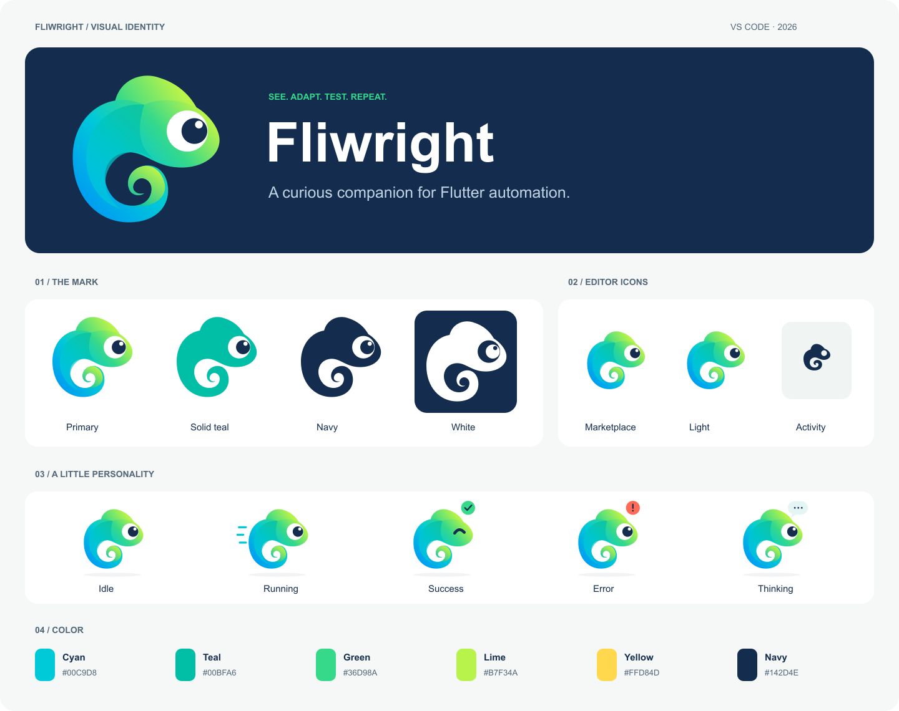

# Fliwright VS Code visual identity

根据 2026-11-04 提供的品牌参考图重绘。矢量源文件可独立使用，不依赖参考图裁切。



## 资源

| 文件 | 用途 |
| --- | --- |
| `../fliwright-marketplace.png` | Marketplace 默认图标，256 × 256，透明底 |
| `../fliwright-activitybar.svg` | 活动栏，24 × 24，`currentColor` 单色简化版 |
| `logo.svg` / `logo.png` | 彩色透明底主标，PNG 为 512 × 512 |
| `logo-teal.svg` / `logo-navy.svg` / `logo-white.svg` | 单色应用；白色版本用于深底 |
| `icon-dark.svg` | Marketplace 透明底图标源文件 |
| `icon-light.svg` / `icon-light.png` | 白底圆角图标 |
| `icon-dark-{16,32,64,128,512}.png` | 指定尺寸导出 |
| `banner.svg` / `banner.png` | README / Marketplace 横幅，1440 × 480 |
| `mascot-{idle,running,success,error,thinking}.svg` | 五种状态插画；状态须搭配文字 |
| `identity.svg` / `identity.png` | 整套视觉一览，1440 × 1140 |

## 配色与使用

品牌原色：Cyan `#00C9D8`、Teal `#00BFA6`、Green `#36D98A`、Lime `#B7F34A`、Yellow `#FFD84D`、Navy `#142D4E`。
渐变用于标志和插画；界面主操作使用纯色。浅色主题以 `#007F73` 配白字，深色主题以 Teal 配 Navy 字，对比度均超过 WCAG AA 普通文字 4.5:1。

Webview 中性色、正文、成功/失败状态、键盘焦点使用 VS Code 原生主题变量；高对比度模式恢复原生按钮与链接颜色，品牌图形单色显示。编辑器界面继续使用用户配置字体；宣传素材优先 Inter，代码优先 JetBrains Mono，均允许系统字体回退，不加载网络字体。

保留主体外接框至少 0.25 倍的留白。独立彩色标志最小 32px，小尺寸 UI 使用单色活动栏图标。按钮不使用渐变，选中状态用轻底色，结果用图标与文字，不使用装饰彩边或状态侧边线。

## 重新生成

所有几何路径、颜色、插画与排版的源定义位于 `../../scripts/generate-marketplace-icon.mjs`。

仅生成 SVG，无额外依赖：

```sh
node packages/fliwright-vscode/scripts/generate-marketplace-icon.mjs --svg-only
```

同时导出 PNG 时，使用环境中已有的 Sharp（不属于插件运行依赖）：

```sh
node packages/fliwright-vscode/scripts/generate-marketplace-icon.mjs --sharp-module /absolute/path/to/sharp/entrypoint.mjs
```

如当前环境能直接解析 `sharp`，可省略 `--sharp-module`。生成的静态资源随源码保存；正常构建无需安装图片工具。
